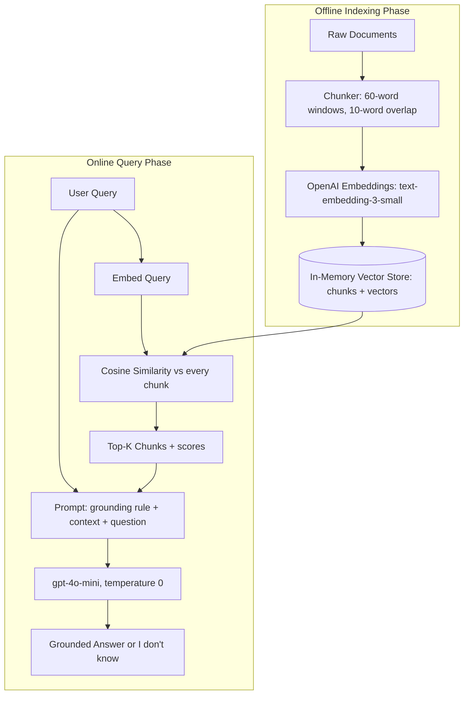

# 01] Standard / Naive / Simple RAG

### Overview
**Standard (Naive) RAG** is the foundational single-step retrieval-augmented generation architecture. It converts documents into fixed-size chunks, embeds them into a vector space, retrieves the top-$k$ nearest neighbors for a user query, and passes them directly to the LLM.

### Architecture
```
Documents ──► Chunking ──► OpenAI Embeddings ──► Vector Store
                                                      │
User Query ──► Query Embedding ──► Cosine Search ◄────┘
                                        │
                                        ▼
                            Top-K Relevant Chunks ──► OpenAI LLM ──► Final Answer
```

<!-- mermaid-01 -->
### Architecture Diagram



### Run
```bash
python main.py
```

