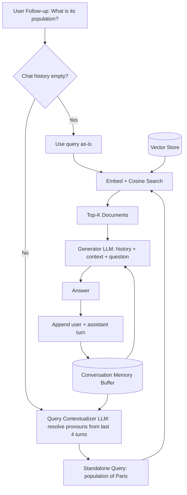

# 02] Simple RAG with Memory

### Overview
**Simple RAG with Memory** extends standard RAG by storing conversation history and using an LLM query-rewriter to resolve pronouns and implicit context (`"its population"` $\rightarrow$ `"Paris population"`) prior to searching the vector store.

### Architecture
```
User Follow-up Query + Chat Memory ──► Query Contextualizer (LLM)
                                               │
                                    Standalone Search Query
                                               │
                                               ▼
                                      Vector DB Retrieval
                                               │
                                               ▼
                       Context + Chat History ──► OpenAI LLM ──► Response (Saved to Memory)
```

<!-- mermaid-02 -->
### Architecture Diagram



### Run
```bash
python main.py
```

