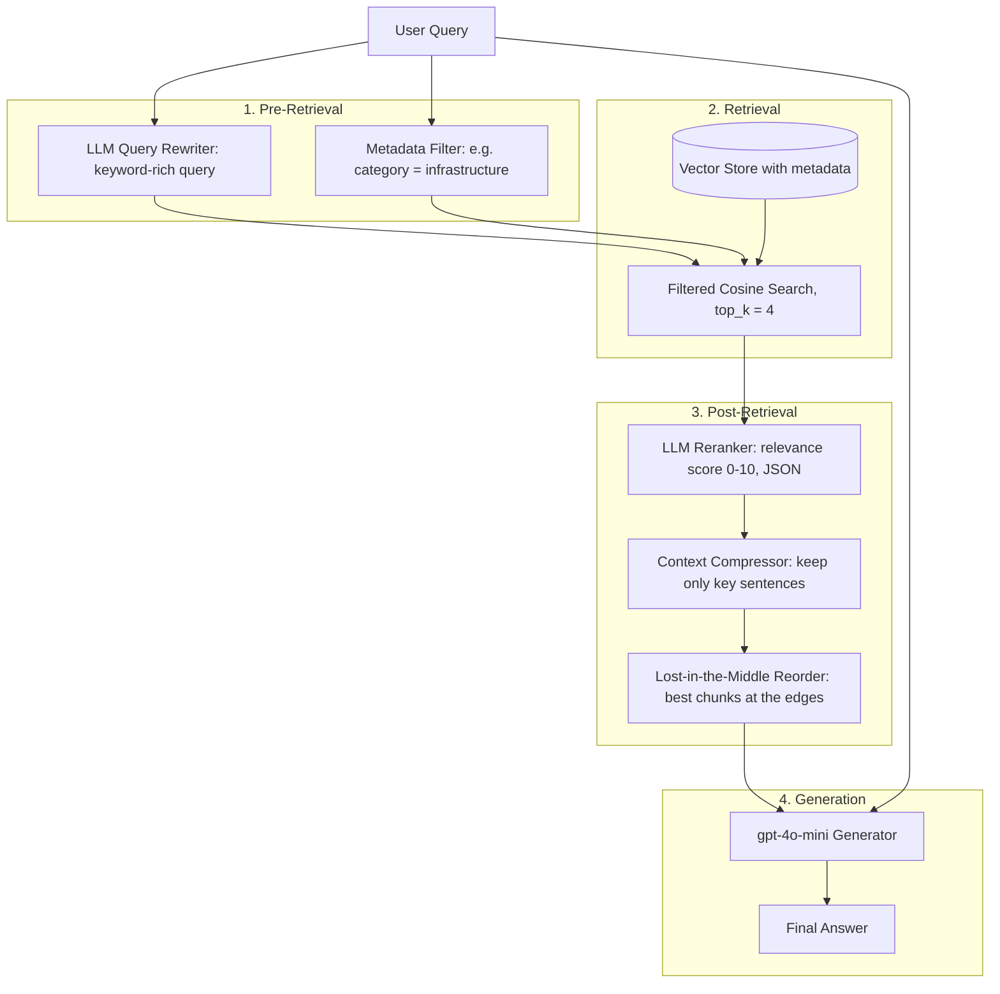

# 03] Advanced RAG

### Overview
**Advanced RAG** addresses the precision and noise problems of Naive RAG by adding structured **Pre-Retrieval** (Query Rewriting, Metadata Filtering) and **Post-Retrieval** (Reranking, Context Compression, and Lost-in-the-Middle Reordering) stages.

### Architecture
```
[Pre-Retrieval]   User Query ──► Query Rewriter + Metadata Filter
                                        │
[Retrieval]                             ▼
                              Filtered Vector Search
                                        │
[Post-Retrieval]                        ▼
                    Reranker ──► Context Compressor ──► Lost-in-the-Middle Reorder
                                                                │
[Generation]                                                    ▼
                                                          OpenAI Generator
```

<!-- mermaid-03 -->
### Architecture Diagram



### Run
```bash
python main.py
```

