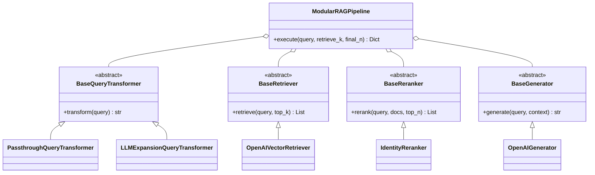

# 04] Modular RAG

### Overview
**Modular RAG** decouples the RAG system into independent, interchangeable interfaces (`BaseQueryTransformer`, `BaseRetriever`, `BaseReranker`, `BaseGenerator`). Modules can be hot-swapped or rearranged without modifying the orchestration engine.

<!-- mermaid-04 -->
### Architecture Diagram

**Pipeline**

```mermaid
flowchart LR
    Q["User Query"] --> ORCH["ModularRAGPipeline Orchestrator"]
    subgraph QT["BaseQueryTransformer"]
        QT1["PassthroughQueryTransformer"]
        QT2["LLMExpansionQueryTransformer"]
    end
    subgraph RT["BaseRetriever"]
        RT1["OpenAIVectorRetriever"]
        RT2["BM25 / Graph / SQL Retriever - pluggable"]
    end
    subgraph RK["BaseReranker"]
        RK1["IdentityReranker"]
        RK2["LLM / Cross-Encoder Reranker - pluggable"]
    end
    subgraph GN["BaseGenerator"]
        GN1["OpenAIGenerator"]
        GN2["Any LLM Generator - pluggable"]
    end
    ORCH -->|"1. transform"| QT
    QT -->|"2. retrieve k=3"| RT
    RT -->|"3. rerank n=2"| RK
    RK -->|"4. generate"| GN
    GN --> A["Answer + transformed query + context used"]
```



**Class Structure**



### Run
```bash
python main.py
```

