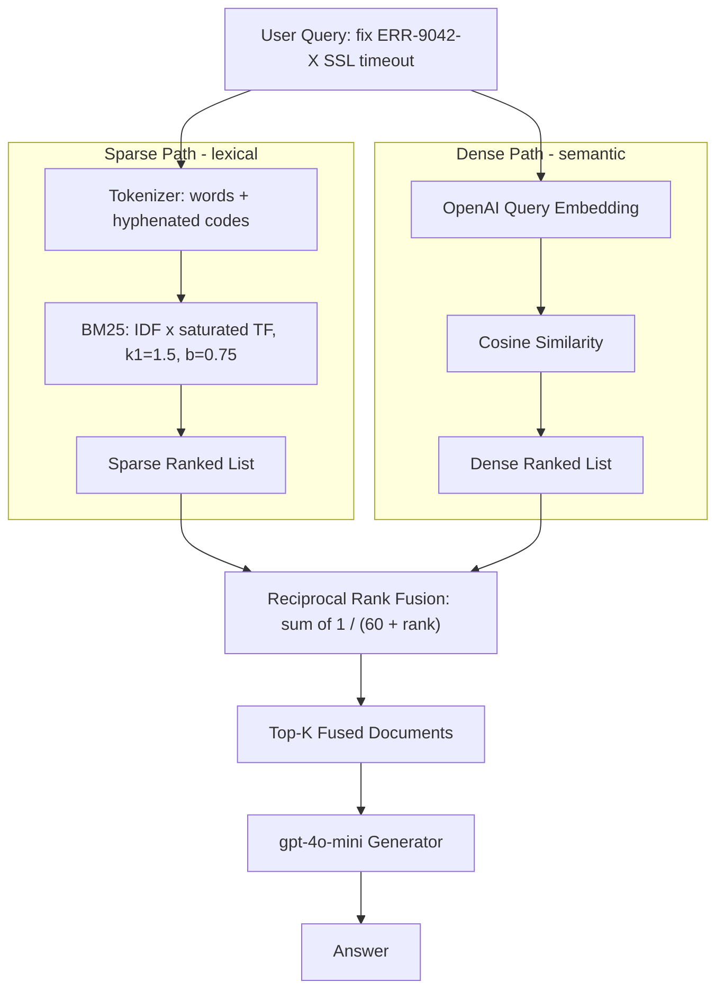

# 05] Hybrid / Fusion RAG

### Overview
**Hybrid / Fusion RAG** combines **Sparse Lexical Retrieval (BM25)** (ideal for exact product codes, SKUs, and error strings) with **Dense Vector Search (OpenAI Embeddings)** (ideal for conceptual similarity) using **Reciprocal Rank Fusion (RRF)**:

$$RRF(d) = \sum_{m \in \{\text{BM25}, \text{Vector}\}} \frac{1}{k + \text{rank}_m(d)}$$

<!-- mermaid-05 -->
### Architecture Diagram



### Run
```bash
python main.py
```

