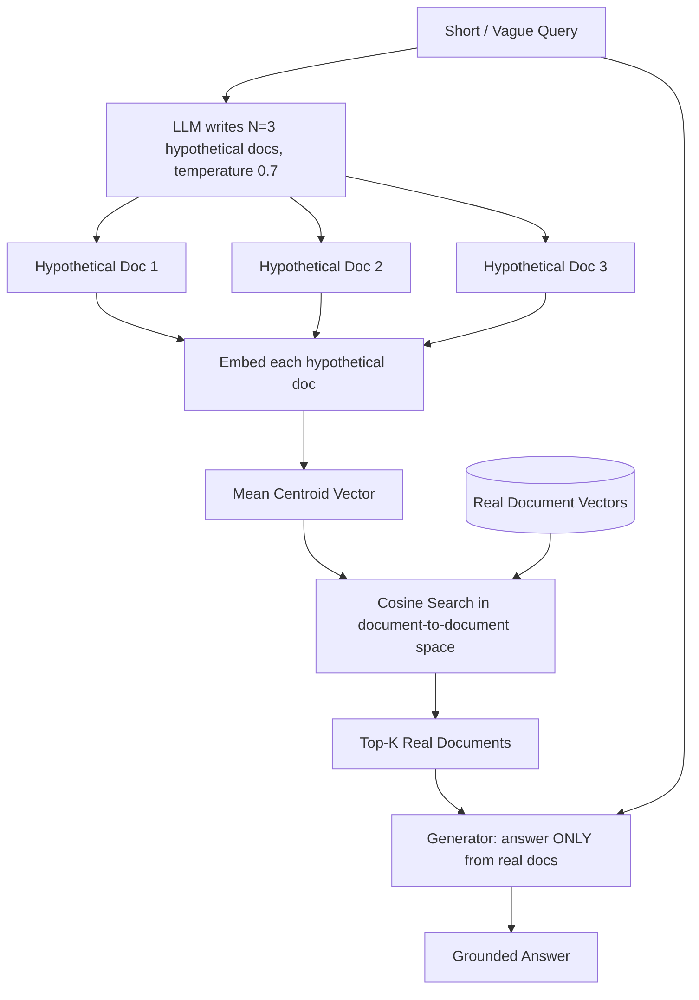

# 06] HyDE (Hypothetical Document Embeddings) RAG

### Overview
**HyDE** bridges the semantic gap between short, vague user questions and dense technical documentation. It prompts the LLM to write hypothetical ideal documents first, averages their embeddings, and searches the real vector store in "document-to-document" embedding space.

### Architecture
```
User Query ──► OpenAI LLM ──► N Hypothetical Answers ──► Average Embedding (Centroid)
                                                                   │
                                                                   ▼
Real Answer ◄── OpenAI LLM ◄── Top-K Real Docs ◄── Vector Similarity Search
```

<!-- mermaid-06 -->
### Architecture Diagram



### Run
```bash
python main.py
```

