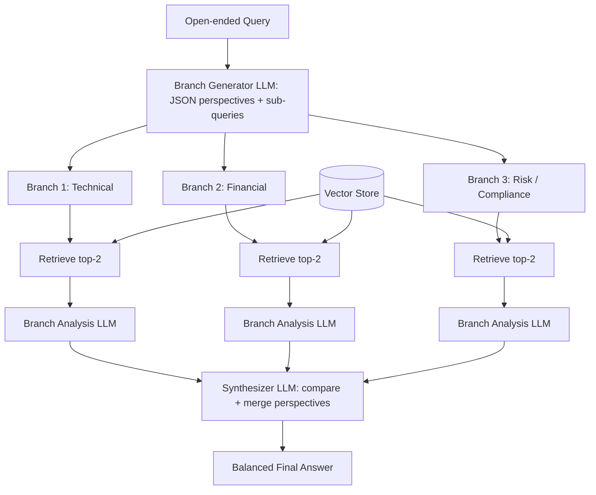

# 07] Branched RAG

### Overview
**Branched RAG** explores multiple lines of thought simultaneously by splitting an open-ended query into distinct perspectives (e.g., Technical, Financial, Compliance), retrieving evidence for each branch in parallel, and synthesizing the multi-perspective results.

<!-- mermaid-07 -->
### Architecture Diagram



### Run
```bash
python main.py
```

