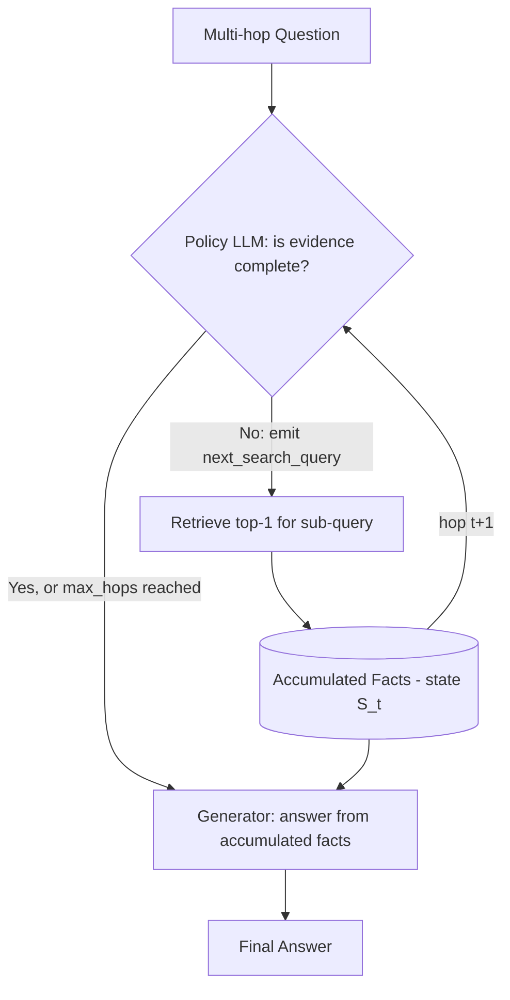
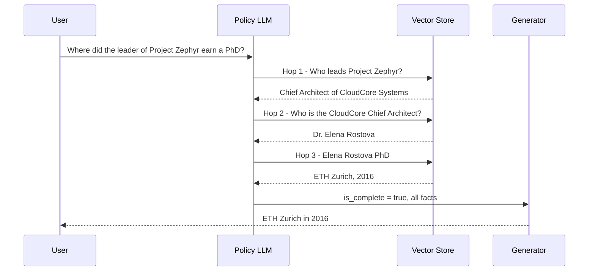

# 08] Iterative / Multi-Hop RAG

### Overview
**Iterative RAG** handles multi-hop questions where the entity needed for the second search is only discovered after reading the result of the first search. It maintains an internal knowledge state and iteratively updates its search query across multiple hops.

<!-- mermaid-08 -->
### Architecture Diagram

**Architecture**



**Example Hop Sequence**



### Run
```bash
python main.py
```

