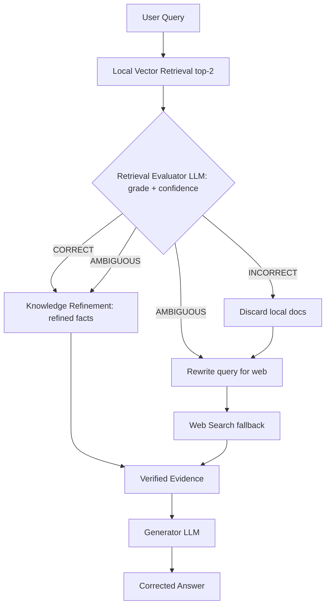

# 09] Corrective RAG (CRAG)

### Overview
**Corrective RAG (CRAG)** introduces an explicit **Retrieval Evaluator** between retrieval and generation. It grades local retrieved documents as `CORRECT`, `AMBIGUOUS`, or `INCORRECT`. When local documents fail or are incomplete, it rewrites the query and falls back to external web search.

<!-- mermaid-09 -->
### Architecture Diagram



### Run
```bash
python main.py
```

