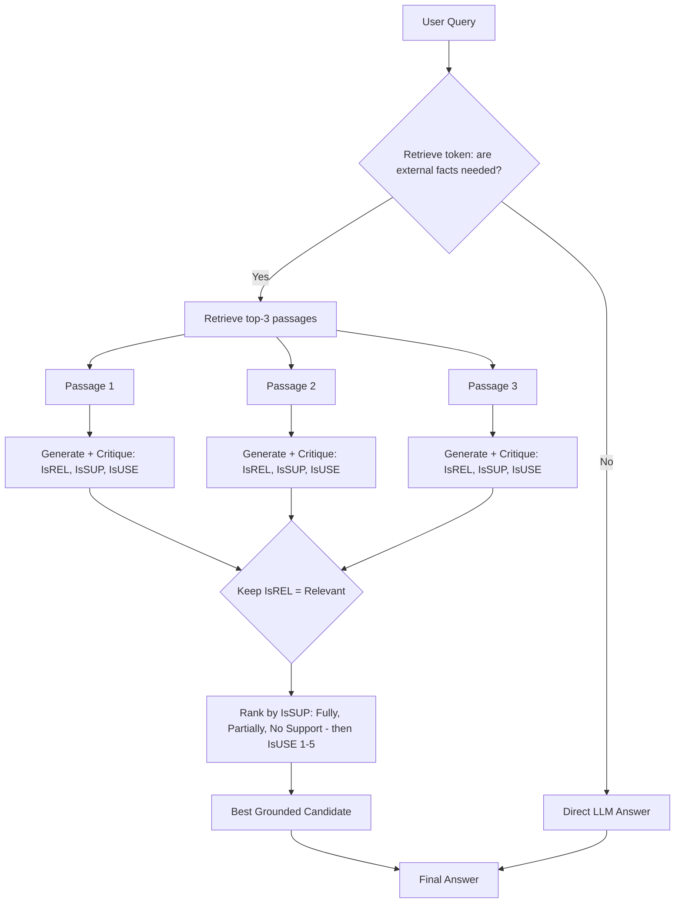

# 10] Self-RAG (Self-Reflective RAG)

### Overview
**Self-RAG** critiques its own retrieval and generation using four reflection decisions:
- `[Retrieve]`: Checks if retrieval is needed.
- `[IsREL]`: Checks if each passage is relevant.
- `[IsSUP]`: Verifies that the generated answer is grounded without hallucinations.
- `[IsUSE]`: Scores overall utility (1–5) to pick the best candidate.

<!-- mermaid-10 -->
### Architecture Diagram



### Run
```bash
python main.py
```

