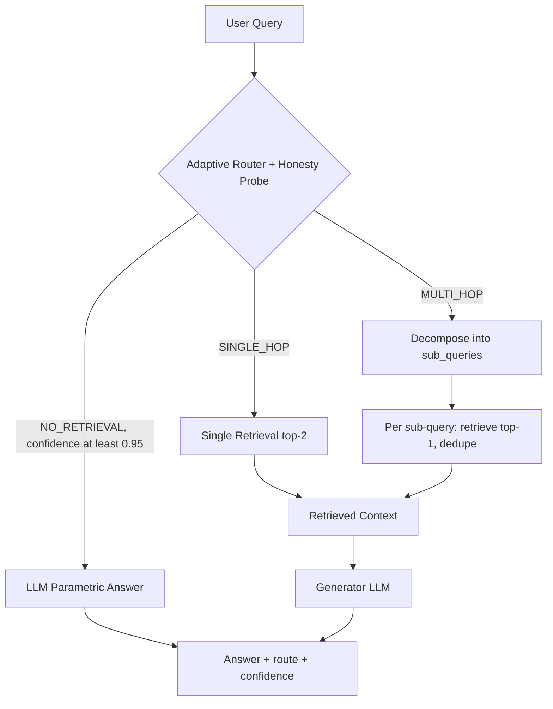

# 11] Adaptive RAG

### Overview
**Adaptive RAG** dynamically selects the optimal retrieval depth (`NO_RETRIEVAL`, `SINGLE_HOP`, or `MULTI_HOP`) based on query complexity and an internal model honesty/confidence probe, avoiding unnecessary retrievals for simple queries while dedicating multi-hop budget to complex ones.

<!-- mermaid-11 -->
### Architecture Diagram



### Run
```bash
python main.py
```

