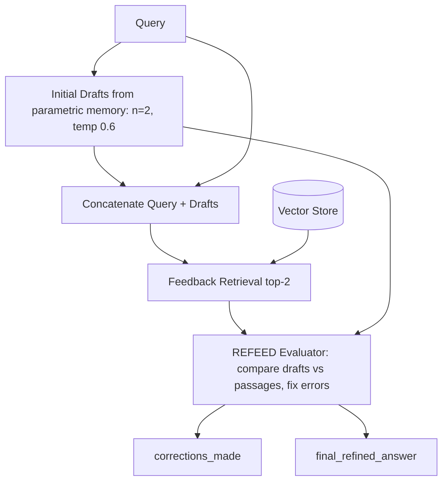

# 12] REFEED (Retrieval Feedback) RAG

### Overview
**REFEED** refines model outputs using retrieval feedback without fine-tuning. It generates initial draft answers first, concatenates `[Query + Initial Drafts]` to retrieve grounding passages, and uses an ensemble ranking pass to correct errors in the initial drafts.

<!-- mermaid-12 -->
### Architecture Diagram



### Run
```bash
python main.py
```

