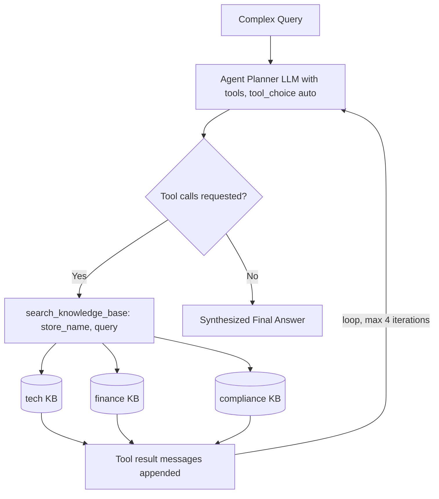
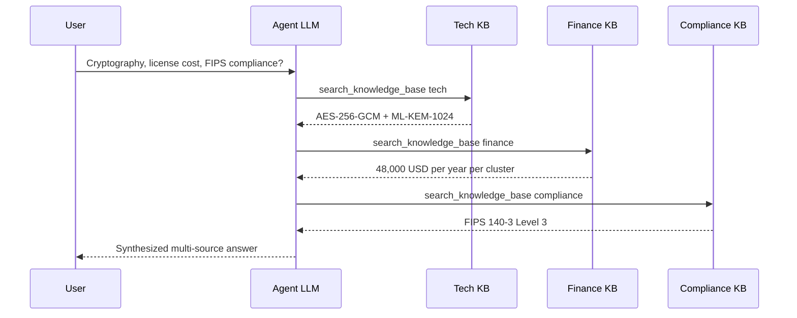

# 13] Agentic RAG

### Overview
**Agentic RAG** uses an autonomous task-planning LLM agent with tool-calling capabilities to dynamically route sub-queries across specialized indices (`tech`, `finance`, `compliance`), inspect retrieved results in real time, and synthesize multi-source answers.

<!-- mermaid-13 -->
### Architecture Diagram

**Architecture**



**Example Tool-Calling Sequence**



### Run
```bash
python main.py
```

