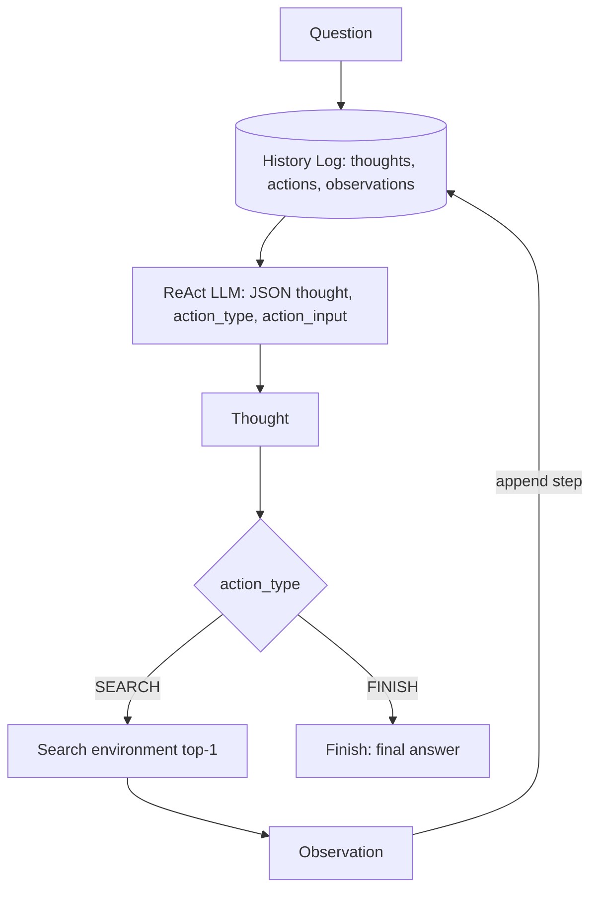
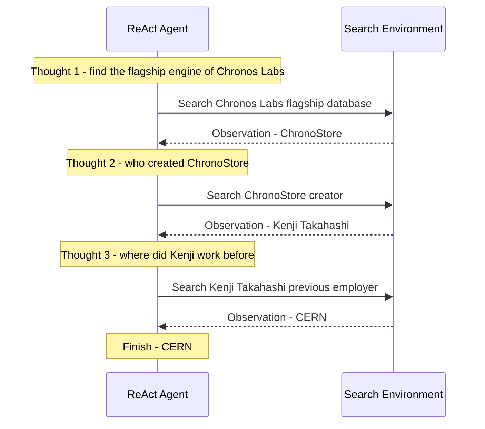

# 14] ReAct (Reason + Act) RAG

### Overview
**ReAct RAG** interleaves explicit verbal reasoning (`Thought`) with environment interactions (`Action: Search[...]`) and feedback (`Observation`). Each observation updates the agent's situational context to guide the next logical thought.

<!-- mermaid-14 -->
### Architecture Diagram

**Architecture**



**Example Trajectory**



### Run
```bash
python main.py
```

