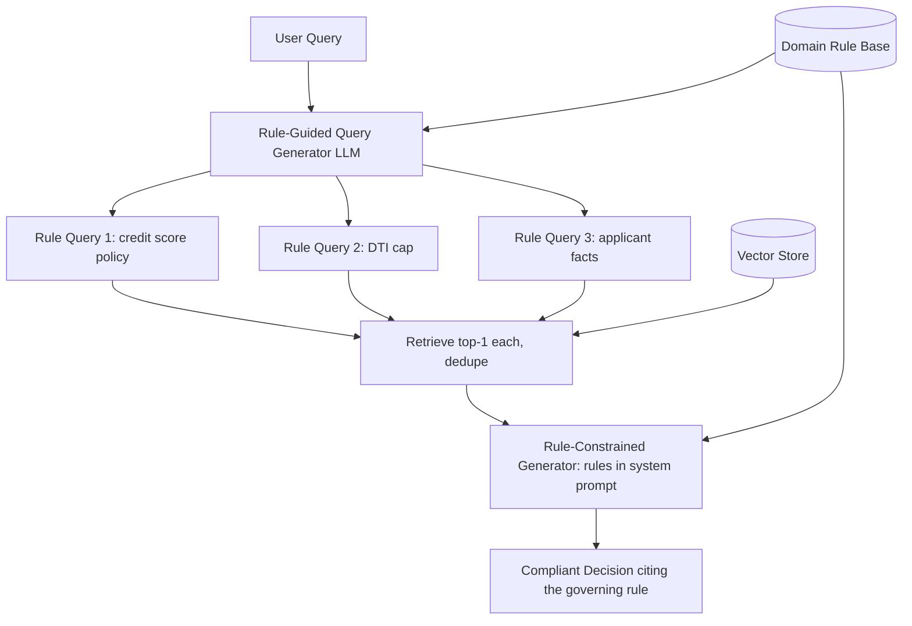

# 15] Rule RAG

### Overview
**Rule RAG** injects explicit deterministic rules into both stages of RAG:
1. **Apply Rules to Guide Retrieval**: Uses rules to identify all mandatory compliance facts to search for.
2. **Apply Rules to Guide Generation**: Constrains the LLM generator to obey logical policies.

<!-- mermaid-15 -->
### Architecture Diagram



### Run
```bash
python main.py
```

