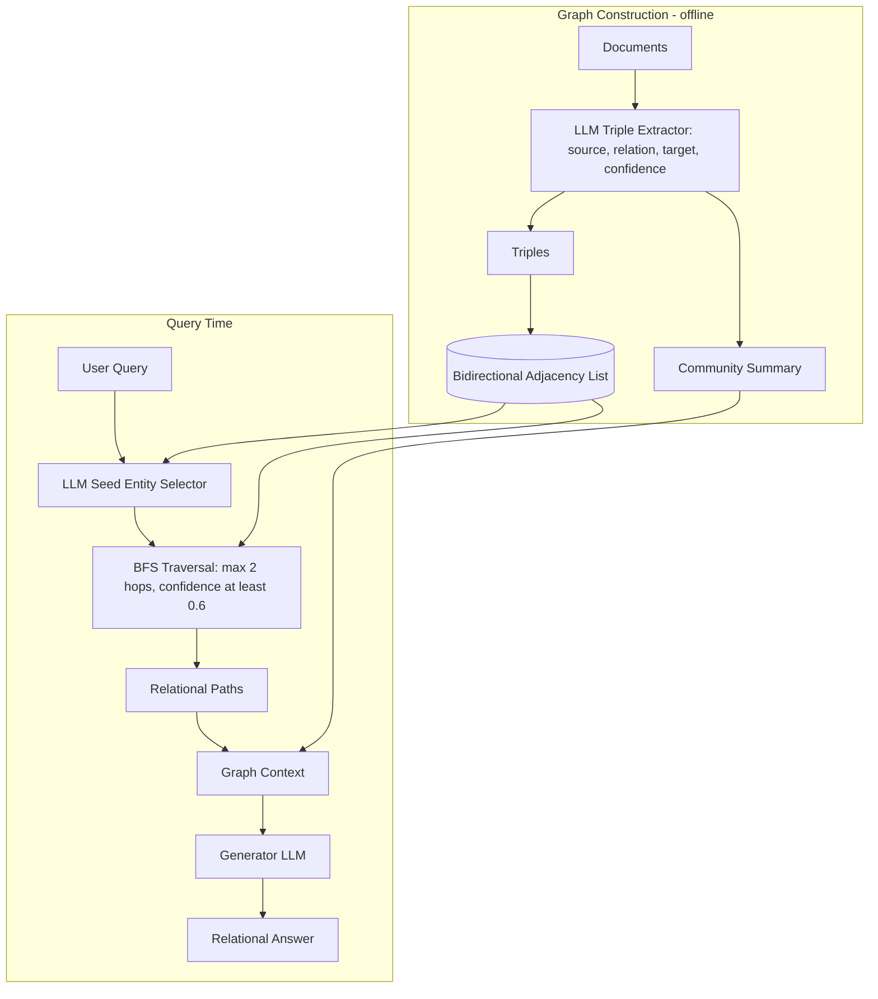
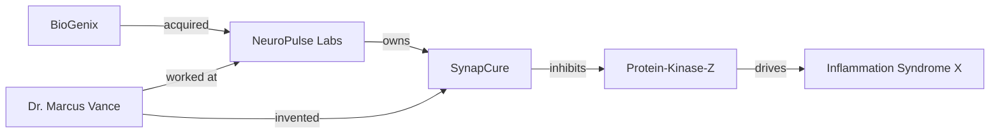

# 16] Graph RAG

### Overview
**Graph RAG** extracts entities, relationships, and confidence scores from unstructured text to construct a **Knowledge Graph** alongside **Community Summaries**. During retrieval, it traverses multi-hop relational paths to uncover connections across documents that standard vector search misses.

<!-- mermaid-16 -->
### Architecture Diagram

**Architecture**



**Example Extracted Knowledge Graph**



### Run
```bash
python main.py
```

