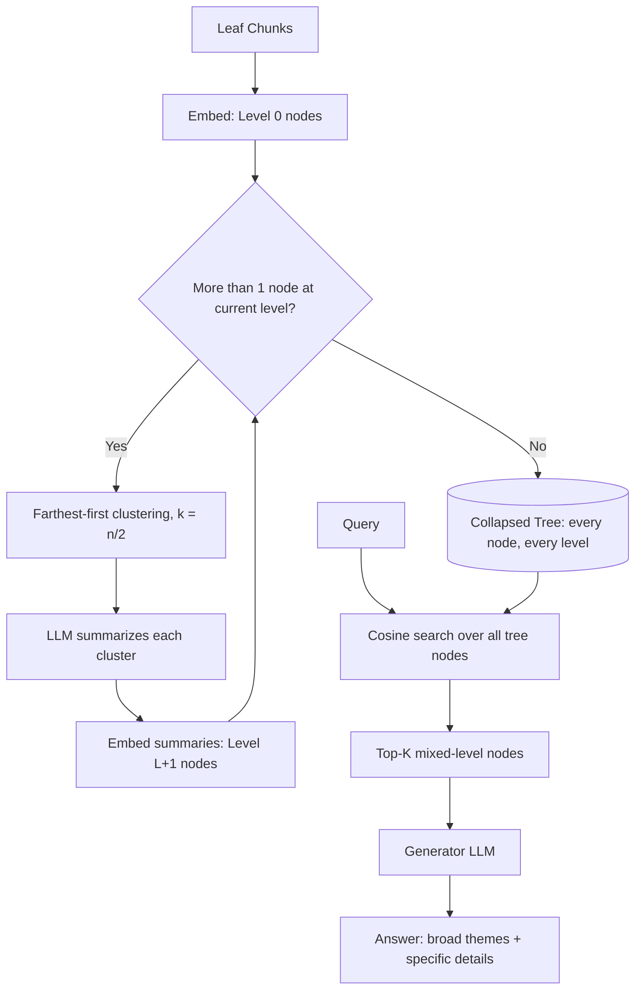
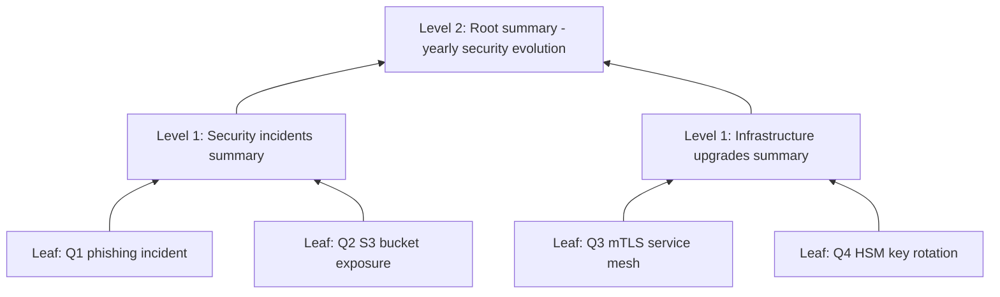

# 17] RAPTOR (Tree-Organized Retrieval)

### Overview
**RAPTOR** recursively clusters and summarizes text chunks bottom-up into a hierarchical abstraction tree:
- **Level 0 (Leaves)**: Fine-grained original chunks.
- **Level 1 (Internal Nodes)**: Cluster-level thematic summaries.
- **Level 2 (Root)**: Global corpus summary.

Using **Collapsed Tree Retrieval**, queries retrieve from all levels simultaneously to combine macro themes with micro details.

<!-- mermaid-17 -->
### Architecture Diagram

**Tree Build + Collapsed Retrieval**



**Resulting Tree**



### Run
```bash
python main.py
```

