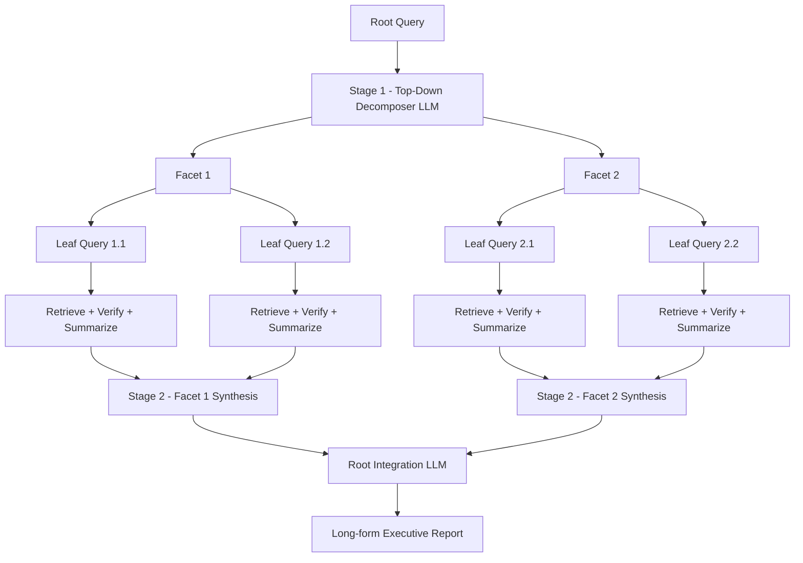

# 18] ConTReGen (Context-Driven Tree-Structured Retrieval)

### Overview
**ConTReGen** solves information gaps in long-form generation via a two-stage tree workflow:
1. **Top-Down Planning & Retrieval**: Decomposes a complex query into hierarchical facets and leaf sub-queries.
2. **Bottom-Up Synthesis**: Summarizes verified passages at each leaf node and integrates them upwards from leaves to root.

<!-- mermaid-18 -->
### Architecture Diagram



### Run
```bash
python main.py
```

