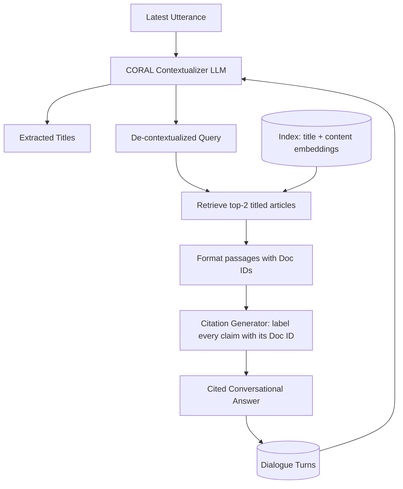

# 19] Conversational RAG (CORAL)

### Overview
**Conversational RAG (CORAL)** handles realistic multi-turn open-domain conversations through **Title Extraction**, **Conversation Flow Contextualization**, **Passage Retrieval**, and **Inline Citation Labeling** (`[Doc1]`, `[Doc2]`).

<!-- mermaid-19 -->
### Architecture Diagram



### Run
```bash
python main.py
```

