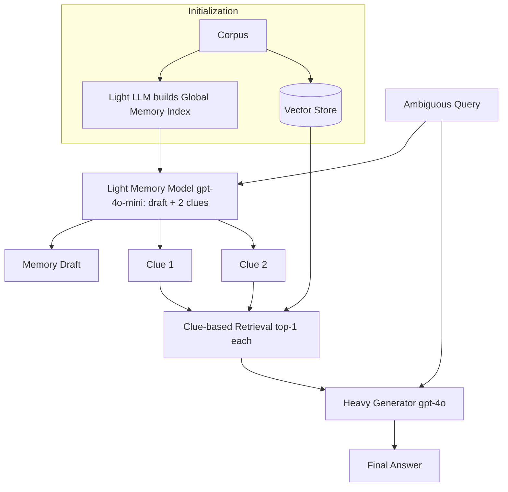

# 20] Memo RAG

### Overview
**Memo RAG** pairs a **Lightweight Memory Model** (`gpt-4o-mini`) that maintains a global memory index and generates retrieval "clues" for vague/ambiguous queries with a **Heavy Generator Model** (`gpt-4o`) that synthesizes the final response from clue-retrieved documents.

<!-- mermaid-20 -->
### Architecture Diagram



### Run
```bash
python main.py
```

