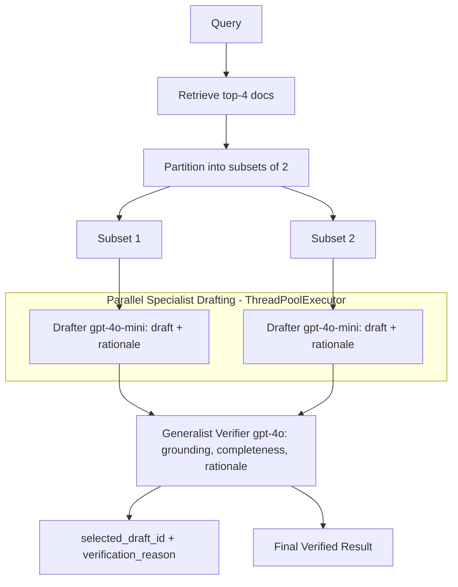

# 21] Speculative RAG

### Overview
**Speculative RAG** partitions retrieved documents into smaller subsets and uses a lightweight **Specialist Drafter Model** (`gpt-4o-mini`) to generate multiple candidate drafts in parallel threads. A larger **Generalist Verifier Model** (`gpt-4o`) evaluates the drafts and rationales to select the most accurate final output.

<!-- mermaid-21 -->
### Architecture Diagram



### Run
```bash
python main.py
```

