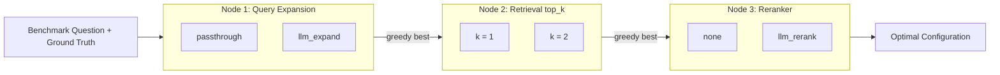
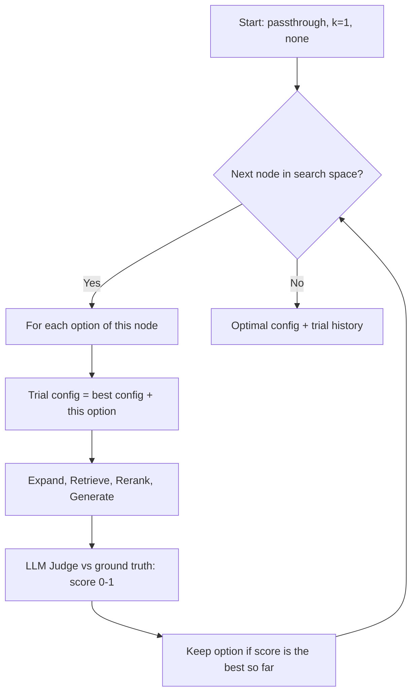

# 22] AutoRAG (Automated RAG Optimization)

### Overview
**AutoRAG** treats the RAG pipeline as a modular node graph (`Query Expansion Node` $\rightarrow$ `Retriever Node` $\rightarrow$ `Reranker Node`) and uses greedy optimization against a ground-truth evaluation dataset to automatically discover the best-performing module configuration.

<!-- mermaid-22 -->
### Architecture Diagram

**Search Space**



**Greedy Optimization Loop**



### Run
```bash
python main.py
```

