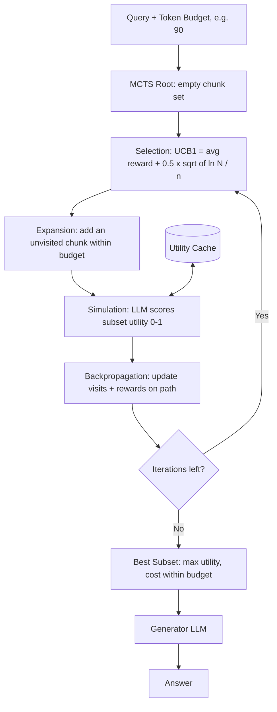

# 23] CORAG (Cost-Constrained RAG)

### Overview
**CORAG** models chunk selection as a combinatorial optimization problem under a strict token/cost budget. Because adding redundant or noisy chunks can reduce utility (non-monotonicity) while consuming budget, CORAG uses **Monte Carlo Tree Search (MCTS)** to find the optimal chunk combination.

<!-- mermaid-23 -->
### Architecture Diagram



### Run
```bash
python main.py
```

