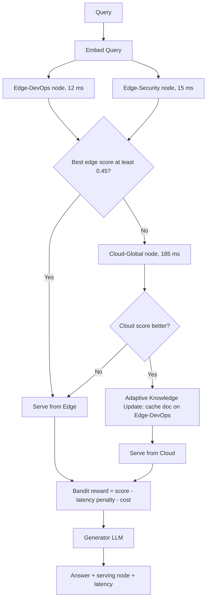

# 24] EACO-RAG (Edge-Assisted Collaborative RAG)

### Overview
**EACO-RAG** distributes vector datasets across low-latency **Edge Nodes** and a central **Cloud Node**. It collaborates across edge nodes first, escalates to the cloud only when local confidence is low, and performs **Adaptive Knowledge Updates** to cache newly retrieved cloud knowledge at the edge.

<!-- mermaid-24 -->
### Architecture Diagram



### Run
```bash
python main.py
```

