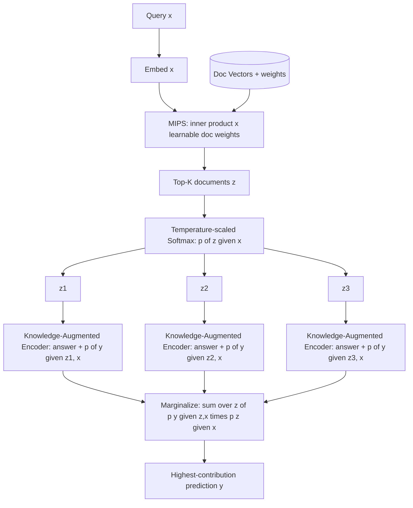

# 25] REALM (Retrieval-Augmented Language Model)

### Overview
**REALM** uses **Maximum Inner Product Search (MIPS)** to compute a retrieval probability distribution $p(z \mid x)$ over the corpus, and marginalizes the generator's predictions across the top-$k$ retrieved documents:

$$p(y \mid x) = \sum_{z \in \text{Top-}K} p(y \mid z, x) \, p(z \mid x)$$

<!-- mermaid-25 -->
### Architecture Diagram



### Run
```bash
python main.py
```

