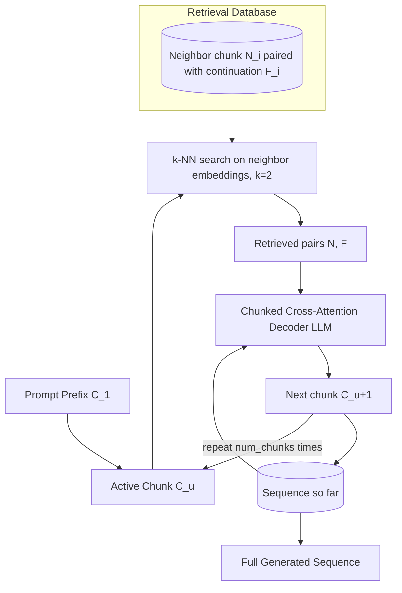

# 26] RETRO (Chunked Cross-Attention RAG)

### Overview
**RETRO** splits the input sequence into contiguous chunks. For each chunk $C_u$, it performs $k$-NN search to retrieve both the matching neighbor chunk $N_i$ **and its continuation chunk** $F_i$ from the database, conditioning the generation of the next chunk $C_{u+1}$ on those continuations.

<!-- mermaid-26 -->
### Architecture Diagram



### Run
```bash
python main.py
```

