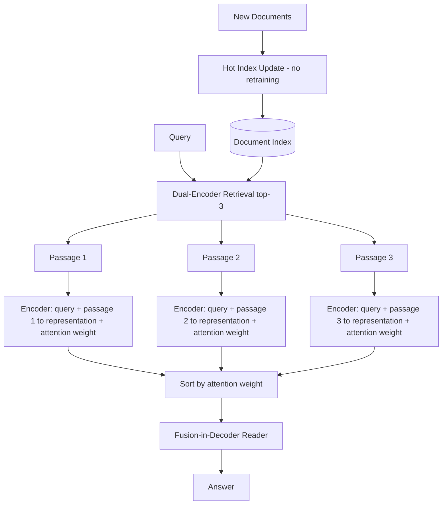

# 27] Attention-based RAG (ATLAS / Fusion-in-Decoder)

### Overview
**ATLAS** combines a **Dual-Encoder Retriever** over a hot-updatable document index with a **Fusion-in-Decoder (FiD)** architecture. Each `(Query, Passage_i)` pair is encoded independently with attention salience weights and fused in the decoder.

<!-- mermaid-27 -->
### Architecture Diagram



### Run
```bash
python main.py
```

