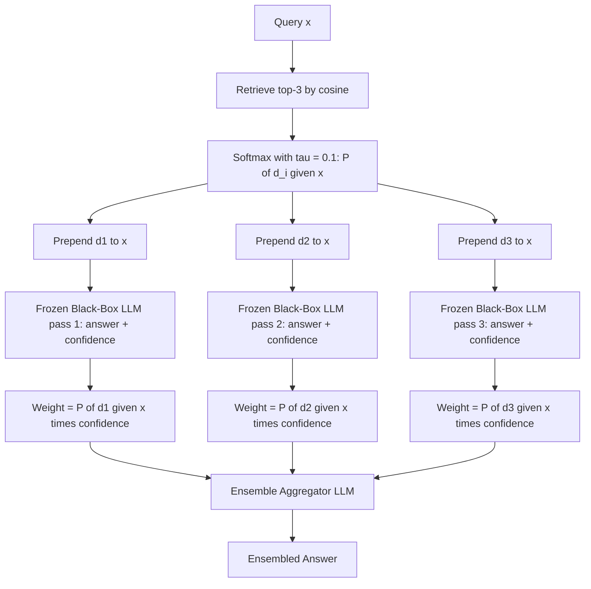

# 28] REPLUG (Black-Box Retrieval Plugin)

### Overview
**REPLUG** treats the LLM as a frozen black box. Instead of concatenating all retrieved passages into one giant prompt, REPLUG prepends each retrieved document $d_i$ **individually** to the query (`[d_i ; x]`), runs parallel passes, and ensembles the output probabilities weighted by retrieval likelihood $P(d_i \mid x)$.

<!-- mermaid-28 -->
### Architecture Diagram



### Run
```bash
python main.py
```

