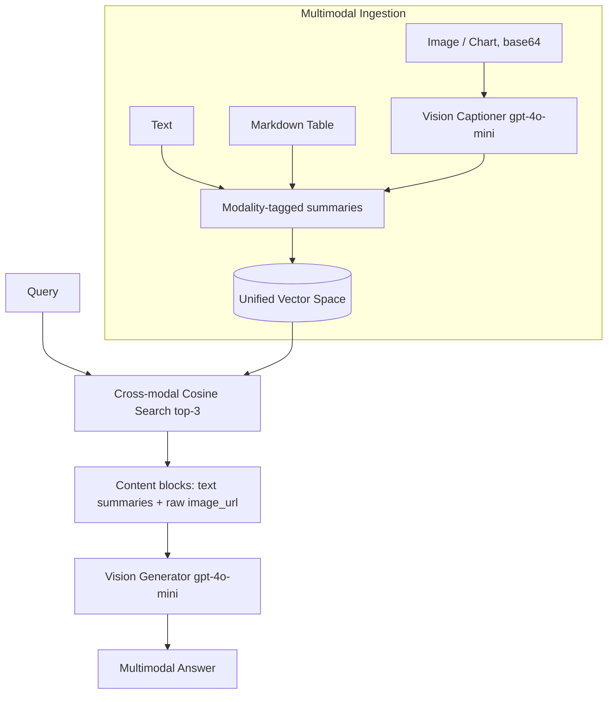

# 29] Multimodal RAG

### Overview
**Multimodal RAG** indexes and retrieves across **Text**, **Structured Tables**, and **Images/Charts** (via OpenAI Vision captioning + raw image payloads) in a shared semantic vector space, synthesizing answers across all media types simultaneously.

<!-- mermaid-29 -->
### Architecture Diagram



### Run
```bash
python main.py
```

