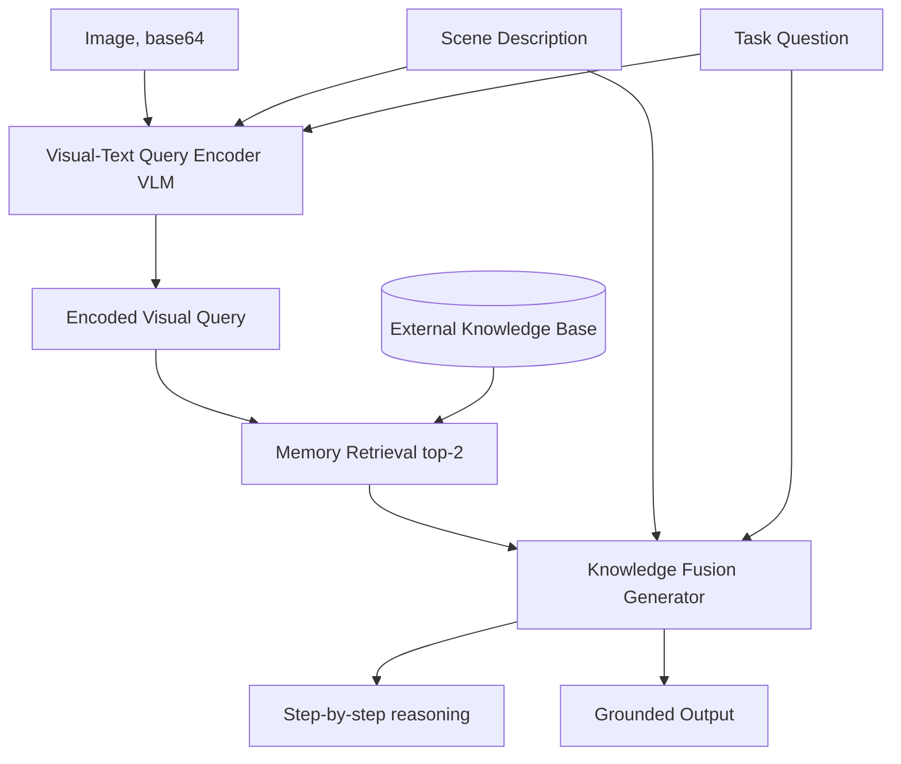

# 30] REVEAL (Visual-Language Model RAG)

### Overview
**REVEAL** grounds visual-language reasoning in real-world facts by combining **Visual-Text Query Encoding**, **Memory Retrieval**, and **Knowledge Fusion**, producing transparent, step-by-step task-solving steps.

<!-- mermaid-30 -->
### Architecture Diagram



### Run
```bash
python main.py
```

