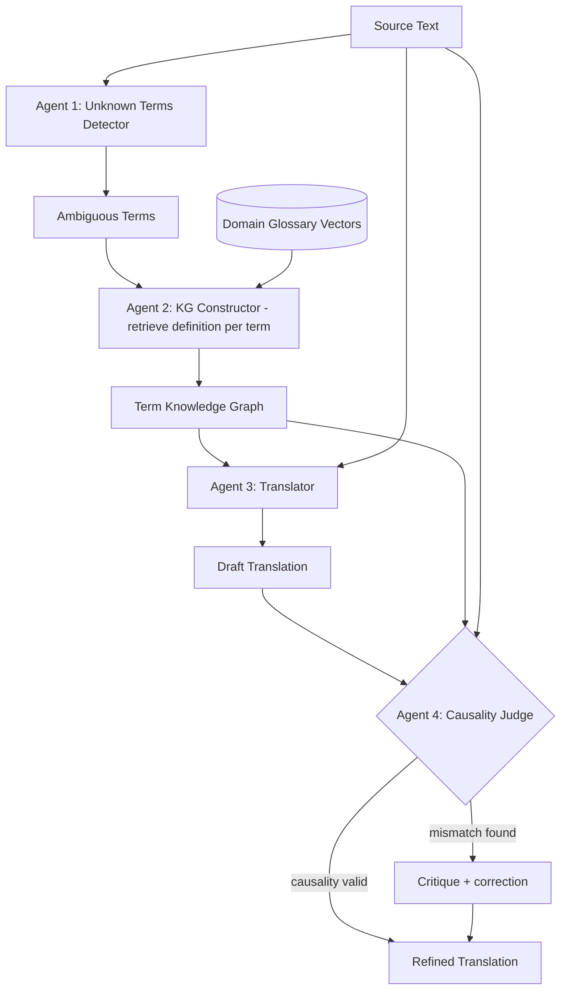

# 31] CRAT (Causality-Enhanced Reflective and Retrieval-Augmented Translation)

### Overview
**CRAT** is a multi-agent RAG system for high-precision technical translation:
1. **Unknown Terms Detector**: Flags polysemous or domain-specific terms.
2. **Knowledge Graph Constructor**: Retrieves authoritative domain definitions.
3. **Translator**: Produces an initial translation grounded in the KG.
4. **Causality-Enhanced Judge**: Validates cause-and-effect consistency and refines the final output.

<!-- mermaid-31 -->
### Architecture Diagram



### Run
```bash
python main.py
```

