# Complete 31 Types of RAG — OpenAI Implementation Repository

This repository contains standalone, runnable Python implementations for **all 31 RAG (Retrieval-Augmented Generation) architectures** using the official **OpenAI API** (`text-embedding-3-small`, `gpt-4o-mini`, and `gpt-4o`).

---

## Setup

1. **Install dependencies**:
   ```bash
   pip install -r requirements.txt
   ```
2. **Configure your OpenAI API key**:
   ```bash
   cp .env.example .env
   export OPENAI_API_KEY="your-api-key"
   ```
3. **Run or verify any implementation**:
   ```bash
   # List all implementations
   python3 run_rag.py --list

   # Verify syntax and classes of all 31 implementations
   python3 run_rag.py --verify

   # Run a specific RAG implementation (e.g. 05] Hybrid_Fusion_RAG)
   python3 run_rag.py --id 5
   ```

---

## Directory Index

| # | Folder | RAG Type | Core Mechanism |
| :-: | :--- | :--- | :--- |
| **01** | `01] Standard_Naive_RAG` | **Standard / Naive RAG** | Chunking $\rightarrow$ Embeddings $\rightarrow$ Cosine Top-$K$ $\rightarrow$ Generation |
| **02** | `02] Simple_RAG_With_Memory` | **Simple RAG with Memory** | Conversational buffer + standalone pronoun query rewriting |
| **03** | `03] Advanced_RAG` | **Advanced RAG** | Query rewrite + metadata filter + reranking + compression + Lost-in-the-Middle reorder |
| **04** | `04] Modular_RAG` | **Modular RAG** | Swappable abstract interfaces (`Transformer`, `Retriever`, `Reranker`, `Generator`) |
| **05** | `05] Hybrid_Fusion_RAG` | **Hybrid / Fusion RAG** | Sparse BM25 + Dense Vector Search + Reciprocal Rank Fusion (RRF) |
| **06** | `06] HyDE_RAG` | **HyDE RAG** | Generates hypothetical draft answers first and embeds their centroid to search |
| **07** | `07] Branched_RAG` | **Branched RAG** | Splits query into parallel analytical branches and synthesizes multi-angle results |
| **08** | `08] Iterative_Multi_Hop_RAG` | **Iterative / Multi-Hop RAG** | Stateful Markov Decision Process (MDP) multi-hop retrieval loop |
| **09** | `09] Corrective_RAG_CRAG` | **Corrective RAG (CRAG)** | Grades local retrieval (`CORRECT`/`AMBIGUOUS`/`INCORRECT`) with Web fallback |
| **10** | `10] Self_RAG` | **Self-RAG** | Self-reflection critique tokens (`[Retrieve]`, `[IsREL]`, `[IsSUP]`, `[IsUSE]`) |
| **11** | `11] Adaptive_RAG` | **Adaptive RAG** | Internal confidence/honesty probe routing (`NO_RETRIEVAL`, `SINGLE_HOP`, `MULTI_HOP`) |
| **12** | `12] REFEED_Retrieval_Feedback_RAG` | **REFEED RAG** | Refines initial pre-retrieval model drafts via retrieval feedback ranking |
| **13** | `13] Agentic_RAG` | **Agentic RAG** | OpenAI tool-calling task planner across specialized domain databases |
| **14** | `14] ReAct_RAG` | **ReAct RAG** | Interleaved `Thought` $\rightarrow$ `Action` $\rightarrow$ `Observation` reasoning loop |
| **15** | `15] Rule_RAG` | **Rule RAG** | Rule-guided query derivation and compliance-enforced generation |
| **16** | `16] Graph_RAG` | **Graph RAG** | Entity-relation triple extraction, community summaries, and subgraph traversal |
| **17** | `17] RAPTOR_Tree_RAG` | **RAPTOR Tree RAG** | Recursive clustering & summarization into a multi-level abstraction tree |
| **18** | `18] ConTReGen_Tree_RAG` | **ConTReGen Tree RAG** | Top-down sub-query tree planning + bottom-up leaf-to-root synthesis |
| **19** | `19] Conversational_CORAL_RAG` | **Conversational RAG (CORAL)** | Title extraction, dialogue flow tracking, and inline `[DocX]` citation labeling |
| **20** | `20] Memo_RAG` | **Memo RAG** | Light memory model generates search clues for a heavy generator LLM |
| **21** | `21] Speculative_RAG` | **Speculative RAG** | Parallel small-model drafting across subsets + large-model verification |
| **22** | `22] Auto_RAG` | **AutoRAG** | Automated greedy optimization over RAG pipeline nodes |
| **23** | `23] CORAG_Cost_Constrained_RAG` | **CORAG** | Monte Carlo Tree Search (MCTS) chunk selection under a strict token budget |
| **24** | `24] EACO_Edge_Collaborative_RAG` | **EACO-RAG** | Edge-cloud collaborative routing with adaptive edge knowledge caching |
| **25** | `25] REALM_RAG` | **REALM** | Maximum Inner Product Search (MIPS) + marginalization over $p(z \mid x)$ |
| **26** | `26] RETRO_Chunked_Cross_Attention_RAG` | **RETRO** | Chunk-by-chunk $k$-NN neighbor + continuation retrieval |
| **27** | `27] ATLAS_Attention_Fusion_RAG` | **ATLAS (Attention RAG)** | Hot-updatable index + Fusion-in-Decoder (FiD) attention weighting |
| **28** | `28] REPLUG_BlackBox_Ensemble_RAG` | **REPLUG** | Frozen black-box LLM parallel prepending + probability-weighted ensemble |
| **29** | `29] Multimodal_RAG` | **Multimodal RAG** | Unified indexing & synthesis across Text, Tables, and OpenAI Vision Images |
| **30** | `30] REVEAL_Visual_Language_RAG` | **REVEAL** | Visual-language query encoding, memory retrieval, and step-by-step knowledge fusion |
| **31** | `31] CRAT_Causality_Translation_RAG` | **CRAT** | Multi-agent unknown term detection, KG construction, and causal translation judging |

---

<!-- mermaid-taxonomy -->
## RAG Taxonomy Map

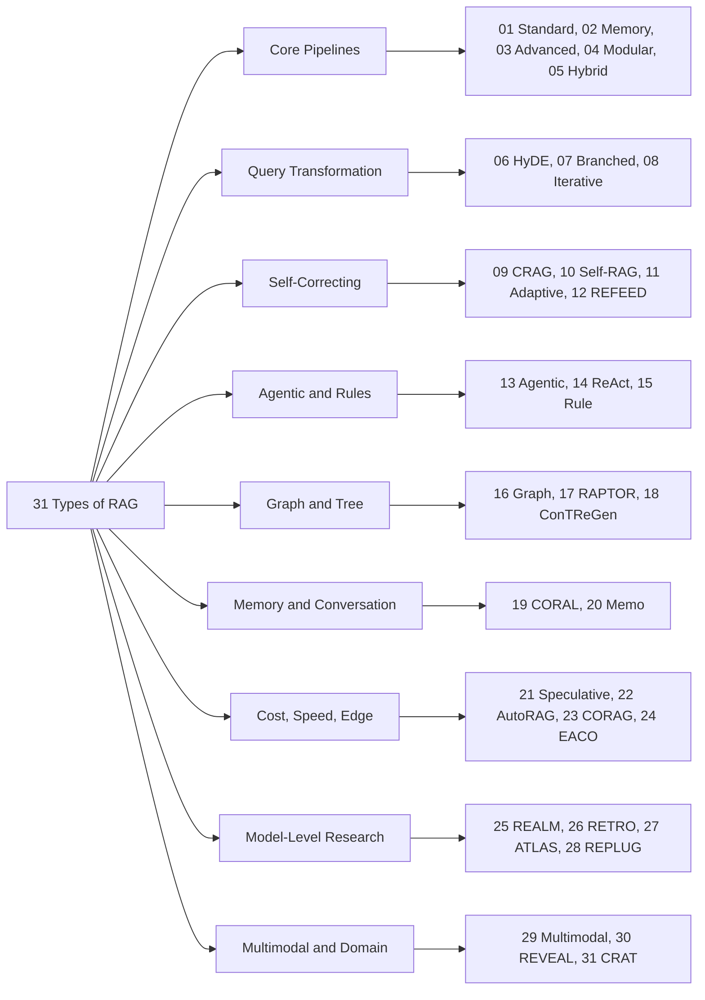

---

## Detailed Definitions of All 31 RAG Architectures

### 01] Standard / Naive / Simple RAG
* **Definition**: The baseline single-step retrieval-augmented generation architecture. It converts documents into fixed-size chunks, embeds them into a vector space, retrieves top-$k$ nearest neighbors for a query, and feeds them to an LLM.
* **How It Works**: Document Chunking $\rightarrow$ Embedding Model $\rightarrow$ Vector Database $\rightarrow$ Cosine Similarity Search $\rightarrow$ LLM Synthesis.
* **Best For**: Basic FAQ search, straightforward question answering, and quick proof-of-concept prototypes.
* **Tradeoffs**: Fast and inexpensive, but prone to retrieval noise and fails on complex multi-hop or out-of-vocabulary queries.


<!-- mermaid-01 -->
#### Architecture Diagram

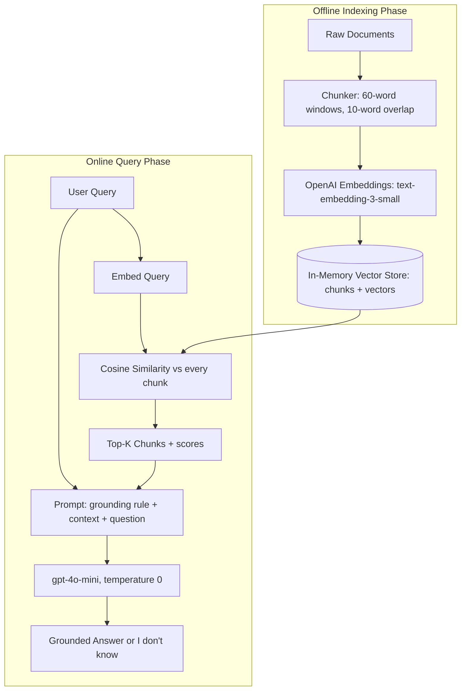

---

### 02] Simple RAG with Memory
* **Definition**: An extension of standard RAG that tracks multi-turn conversational context to resolve pronouns, ellipsis, and context shifts.
* **How It Works**: Retains chat history in a rolling memory buffer. Uses an LLM to rewrite follow-up questions containing pronouns (e.g., *"What is its population?"* $\rightarrow$ *"What is the population of Paris?"*) into standalone search queries before vector lookup.
* **Best For**: Conversational chatbots, customer support assistants, and personalized tutoring.
* **Tradeoffs**: Prevents context loss across turns, but adds a small latency and token cost overhead for query reformulation.


<!-- mermaid-02 -->
#### Architecture Diagram

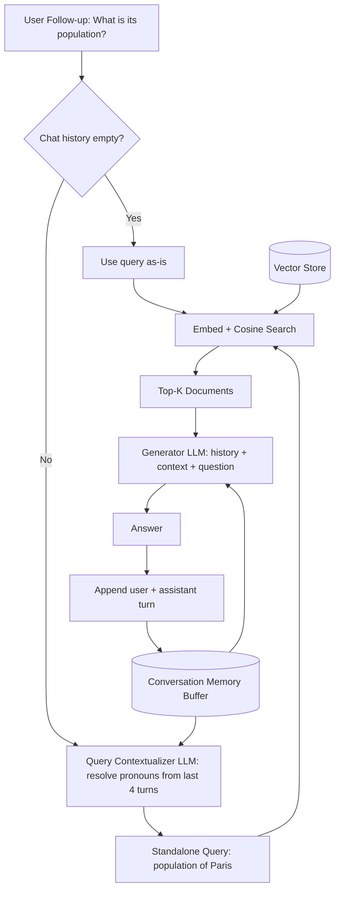

---

### 03] Advanced RAG
* **Definition**: A multi-stage optimized pipeline that adds structured pre-retrieval and post-retrieval processing layers around vector search.
* **How It Works**: 
  1. *Pre-Retrieval*: Query expansion/rewriting and metadata filtering.
  2. *Retrieval*: High-recall vector search.
  3. *Post-Retrieval*: Cross-encoder reranking, context compression (removing irrelevant sentences), and Lost-in-the-Middle reordering (placing top passages at context boundaries).
* **Best For**: Production enterprise search, legal/technical document retrieval, and high-precision Q&A.
* **Tradeoffs**: Substantially higher answer relevance and lower noise, but higher implementation complexity.


<!-- mermaid-03 -->
#### Architecture Diagram

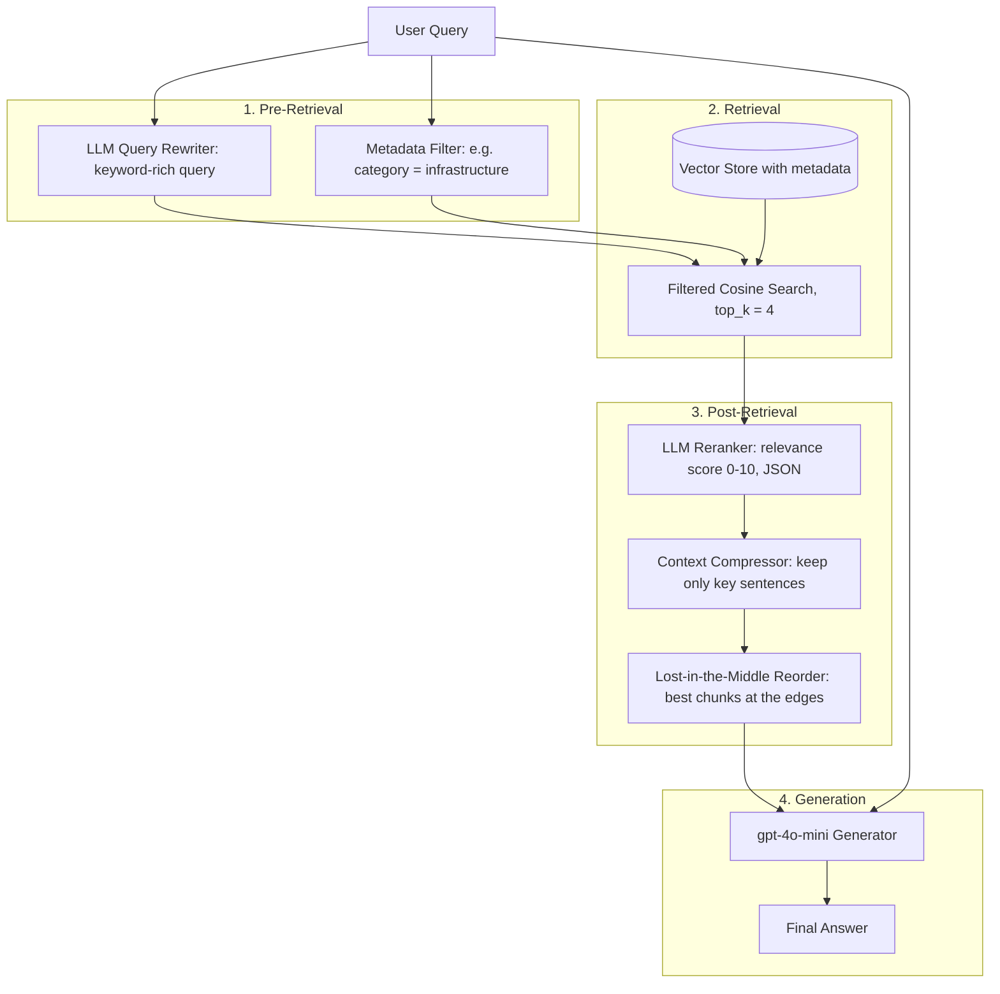

---

### 04] Modular RAG
* **Definition**: A decoupled, composable RAG architecture where each functional stage is defined as an independent, interchangeable module.
* **How It Works**: Defines abstract interfaces (`BaseQueryTransformer`, `BaseRetriever`, `BaseReranker`, `BaseGenerator`). Modules can be swapped (e.g., swapping dense vectors for BM25 or changing generators) without modifying the orchestration logic.
* **Best For**: Large-scale enterprise systems, multi-tenant AI platforms, and experimental benchmarking pipelines.
* **Tradeoffs**: Maximum architectural flexibility and ease of upgrading, but requires careful interface design.


<!-- mermaid-04 -->
#### Architecture Diagram

**Pipeline**

```mermaid
flowchart LR
    Q["User Query"] --> ORCH["ModularRAGPipeline Orchestrator"]
    subgraph QT["BaseQueryTransformer"]
        QT1["PassthroughQueryTransformer"]
        QT2["LLMExpansionQueryTransformer"]
    end
    subgraph RT["BaseRetriever"]
        RT1["OpenAIVectorRetriever"]
        RT2["BM25 / Graph / SQL Retriever - pluggable"]
    end
    subgraph RK["BaseReranker"]
        RK1["IdentityReranker"]
        RK2["LLM / Cross-Encoder Reranker - pluggable"]
    end
    subgraph GN["BaseGenerator"]
        GN1["OpenAIGenerator"]
        GN2["Any LLM Generator - pluggable"]
    end
    ORCH -->|"1. transform"| QT
    QT -->|"2. retrieve k=3"| RT
    RT -->|"3. rerank n=2"| RK
    RK -->|"4. generate"| GN
    GN --> A["Answer + transformed query + context used"]
```

**Class Structure**

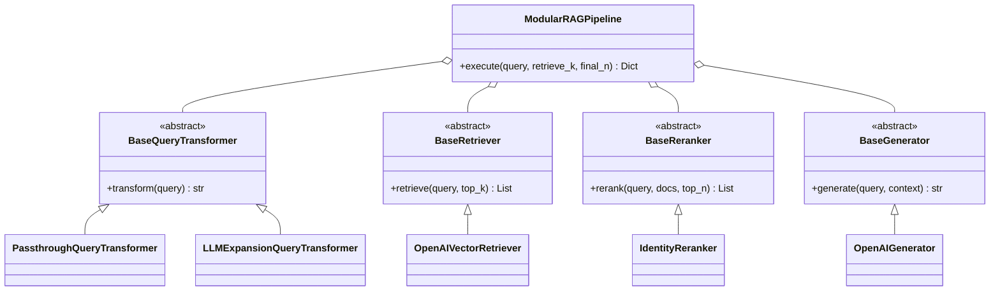

---

### 05] Hybrid / Fusion RAG
* **Definition**: An architecture that merges sparse keyword retrieval (BM25) with dense semantic vector search using Reciprocal Rank Fusion (RRF).
* **How It Works**: Runs BM25 and vector search concurrently over the corpus. Merges candidate rankings using the RRF formula: $RRF(d) = \sum_{m} \frac{1}{k + rank_m(d)}$, ensuring both exact keyword hits (SKUs, IDs) and semantic matches rank high.
* **Best For**: Systems requiring both exact keyword precision (error codes, product numbers, legal IDs) and conceptual understanding.
* **Tradeoffs**: Solves the keyword blindness of pure vector search, but requires maintaining two search indexes.


<!-- mermaid-05 -->
#### Architecture Diagram

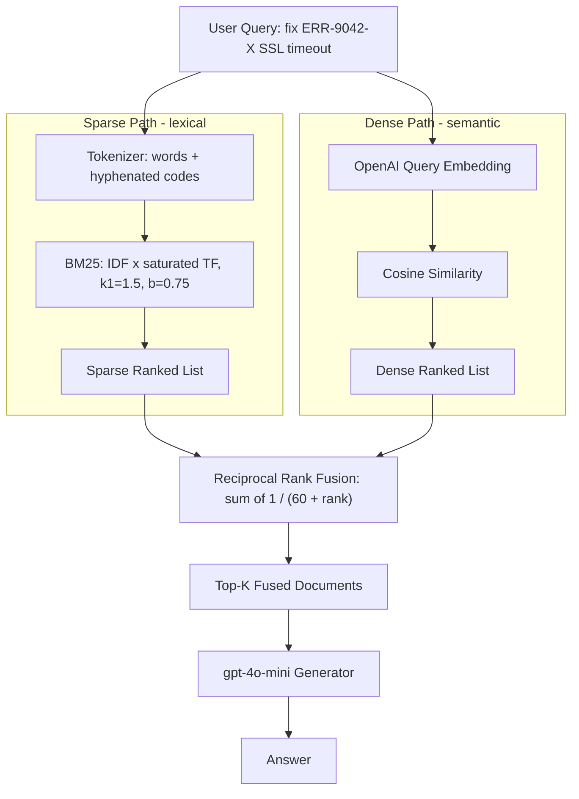

---

### 06] HyDE (Hypothetical Document Embeddings) RAG
* **Definition**: A pre-retrieval query transformation technique that generates a hypothetical draft answer before performing vector search.
* **How It Works**: Asks the LLM to hallucinate/speculate what an ideal technical answer would look like. Computes the embedding of that hypothetical answer and uses it to search the vector database in document-to-document embedding space.
* **Best For**: Short, ambiguous, or abstract questions where user terminology differs drastically from corpus terminology.
* **Tradeoffs**: Dramatically improves semantic matching for hard queries, but hallucinated drafts can occasionally bias retrieval.


<!-- mermaid-06 -->
#### Architecture Diagram

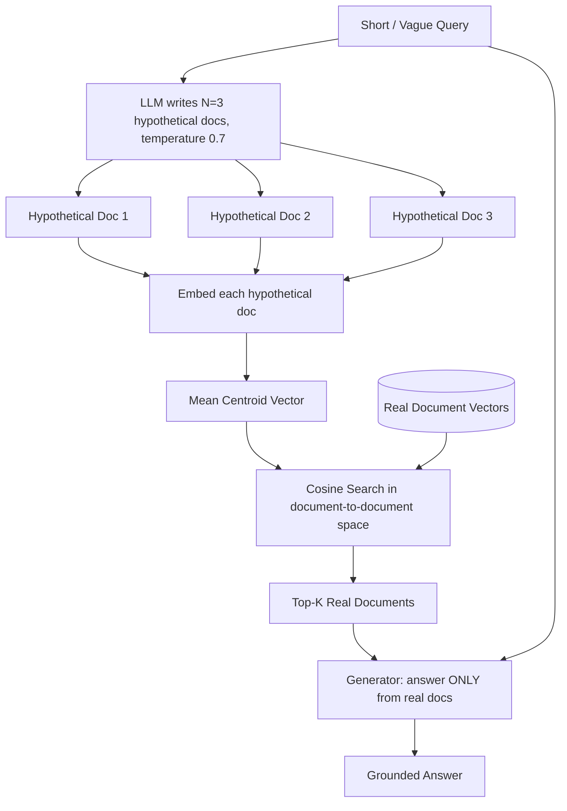

---

### 07] Branched RAG
* **Definition**: A multi-path retrieval architecture that explores multiple interpretations or analytical perspectives of a query simultaneously.
* **How It Works**: Decomposes an open-ended question into multiple distinct branches (e.g., Technical, Financial, Compliance), retrieves supporting documents for each branch in parallel, and synthesizes a balanced master response.
* **Best For**: Market intelligence, investment research, policy analysis, and multifaceted business strategy decisions.
* **Tradeoffs**: Produces comprehensive, well-rounded answers, but multiplies token usage and latency.


<!-- mermaid-07 -->
#### Architecture Diagram

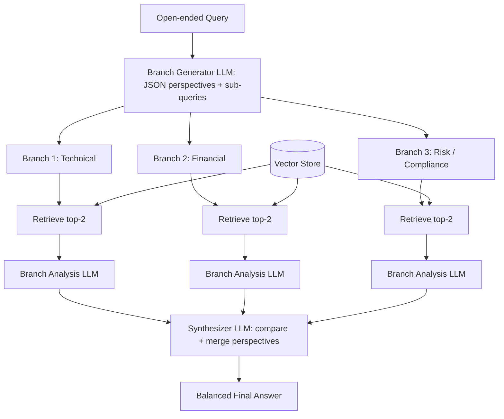

---

### 08] Iterative / Multi-Hop RAG
* **Definition**: A stateful sequential retrieval paradigm that models discovery as a Markov Decision Process (MDP) to solve bridge-entity questions.
* **How It Works**: Retrieves an initial fact, assesses what information is still missing, formulates a new conditioned sub-query, and repeats retrieval across multiple hops until the complete evidence chain is assembled.
* **Best For**: Investigative research, complex multi-step reasoning, and discovering connections across disparate documents.
* **Tradeoffs**: Capable of solving questions no single-shot retriever can answer, but latency scales with the number of hops.


<!-- mermaid-08 -->
#### Architecture Diagram

**Architecture**

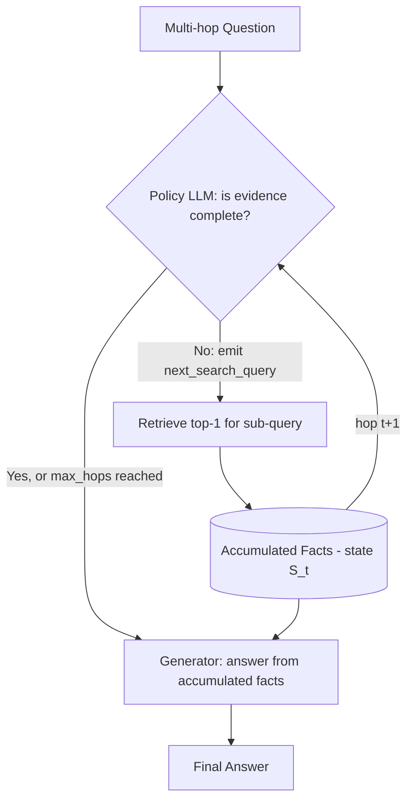

**Example Hop Sequence**

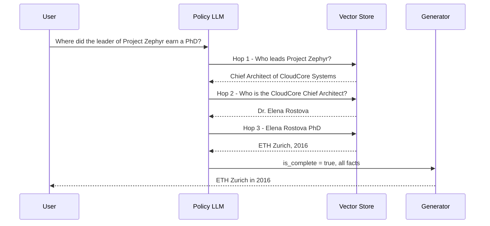

---

### 09] Corrective RAG (CRAG)
* **Definition**: A self-correcting RAG architecture that incorporates an active Retrieval Evaluator to grade document relevance and trigger fallbacks.
* **How It Works**: Retrieves local candidates, then an evaluator grades them as `CORRECT`, `AMBIGUOUS`, or `INCORRECT`. If local documents are irrelevant or insufficient, CRAG strips them, rewrites the query, and triggers external web search fallback.
* **Best For**: Mission-critical applications, automated fact-checking, and enterprise systems where hallucinations are unacceptable.
* **Tradeoffs**: Guarantees answer reliability even with an incomplete internal knowledge base, but incurs extra latency on fallbacks.


<!-- mermaid-09 -->
#### Architecture Diagram

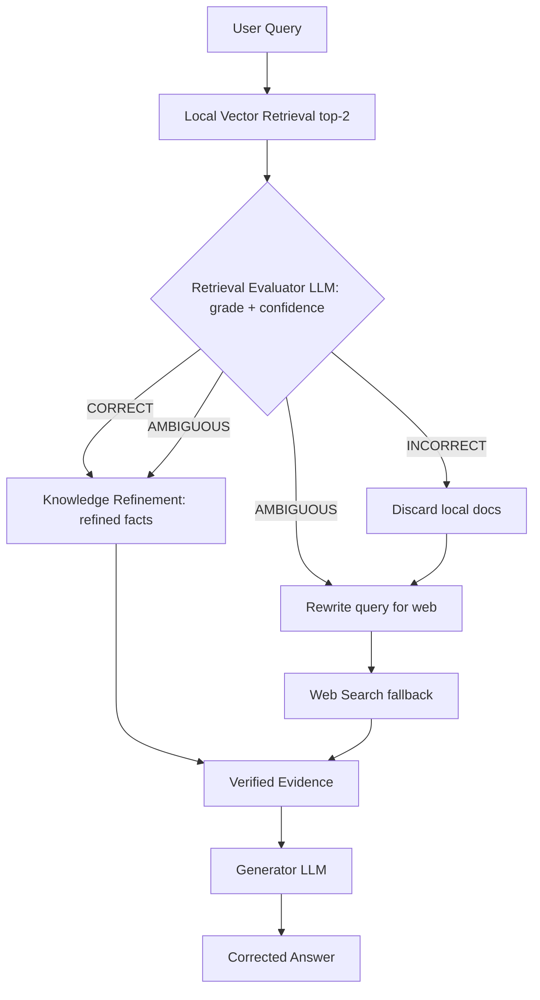

---

### 10] Self-RAG (Self-Reflective RAG)
* **Definition**: A fine-grained reflective RAG framework that uses special critique and reflection tokens to regulate retrieval and verify factual grounding.
* **How It Works**: Evaluates four reflection decisions:
  - `[Retrieve]`: Determines if external facts are even required.
  - `[IsREL]`: Grades whether each retrieved passage is relevant.
  - `[IsSUP]`: Checks if the generated answer is strictly grounded without hallucination.
  - `[IsUSE]`: Rates utility (1–5) to select the best output.
* **Best For**: High-auditability domains (healthcare, legal, regulatory compliance) demanding complete verification.
* **Tradeoffs**: Exceptional precision and elimination of ungrounded statements, but requires multiple critique passes.


<!-- mermaid-10 -->
#### Architecture Diagram

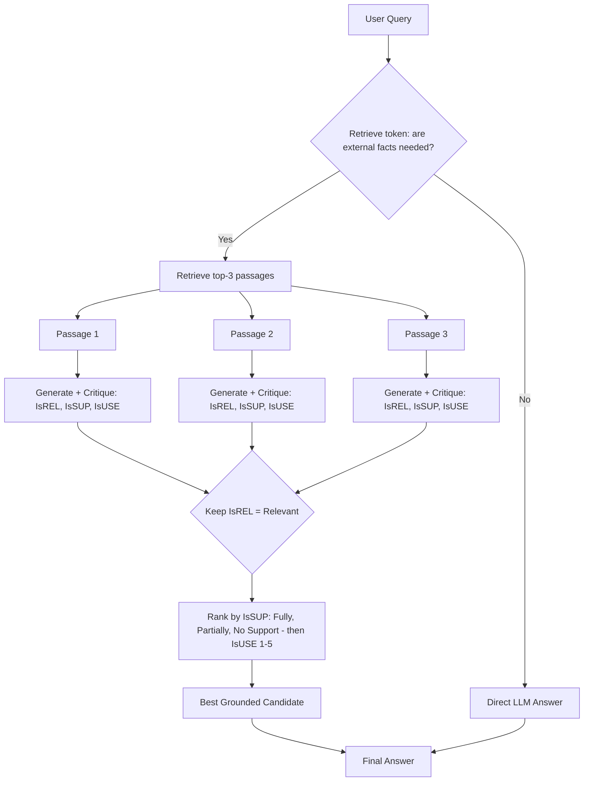

---

### 11] Adaptive RAG
* **Definition**: A dynamic routing architecture that inspects query complexity and internal model confidence to select the most efficient retrieval strategy.
* **How It Works**: Evaluates an honesty probe. If the model knows the answer with high confidence, it uses `NO_RETRIEVAL`. For standard factual lookups, it uses `SINGLE_HOP`. For complex analytical queries, it triggers `MULTI_HOP`.
* **Best For**: Production platforms handling a heterogeneous mix of chit-chat, simple lookups, and deep research tasks.
* **Tradeoffs**: Optimizes compute budget and latency by eliminating unnecessary retrievals for easy questions.


<!-- mermaid-11 -->
#### Architecture Diagram

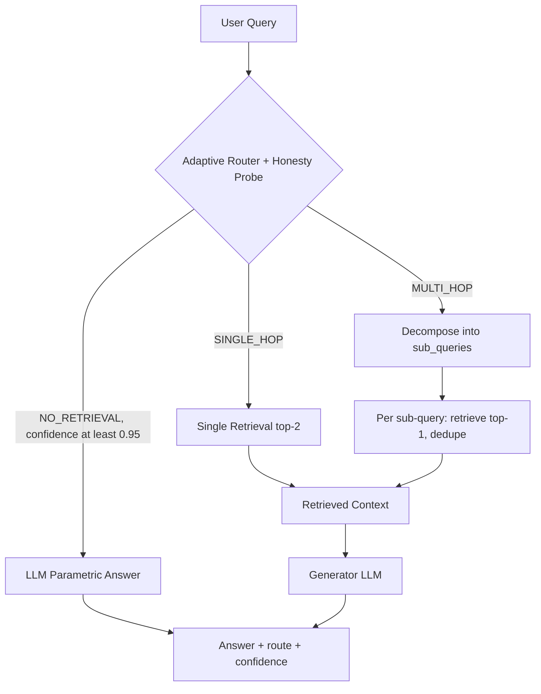

---

### 12] REFEED (Retrieval Feedback) RAG
* **Definition**: A post-hoc output refinement technique that improves answers using retrieval feedback without requiring model fine-tuning.
* **How It Works**: The LLM generates initial pre-retrieval draft answers. It then concatenates `[Query + Draft Answers]` to retrieve grounding passages, comparing the pre- and post-retrieval versions to fix inaccuracies.
* **Best For**: Scenarios where the model has partial internal knowledge that can guide retrieval to the exact missing details.
* **Tradeoffs**: Refines answers without training weights, but requires both pre- and post-generation steps.


<!-- mermaid-12 -->
#### Architecture Diagram

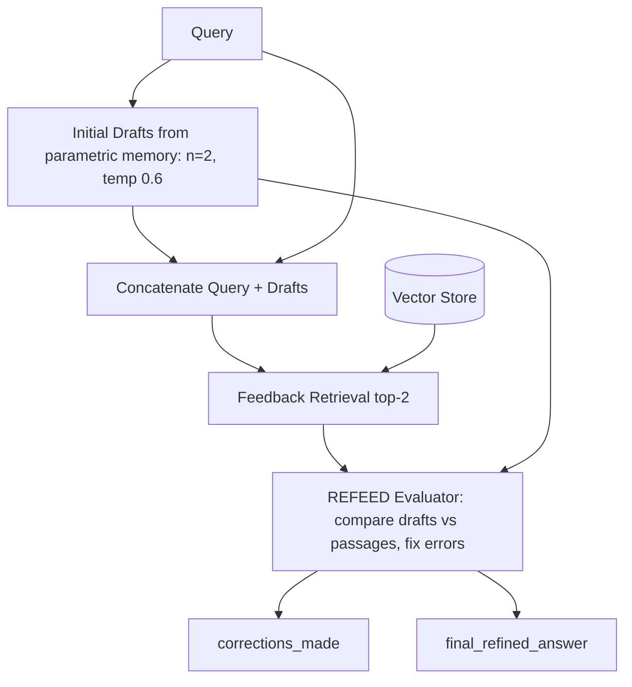

---

### 13] Agentic RAG
* **Definition**: An autonomous agent-driven RAG architecture equipped with multi-step task planning and dynamic tool invocation.
* **How It Works**: An LLM agent evaluates the user prompt, breaks it down, and invokes function-calling tools across specialized databases (e.g., Tech DB, Finance DB, Compliance DB), observing results and deciding subsequent steps.
* **Best For**: Complex enterprise workflows, financial portfolio analysis, and cross-departmental operations.
* **Tradeoffs**: Highly intelligent and adaptable to ambiguous goals, but execution cost and latency are variable.


<!-- mermaid-13 -->
#### Architecture Diagram

**Architecture**

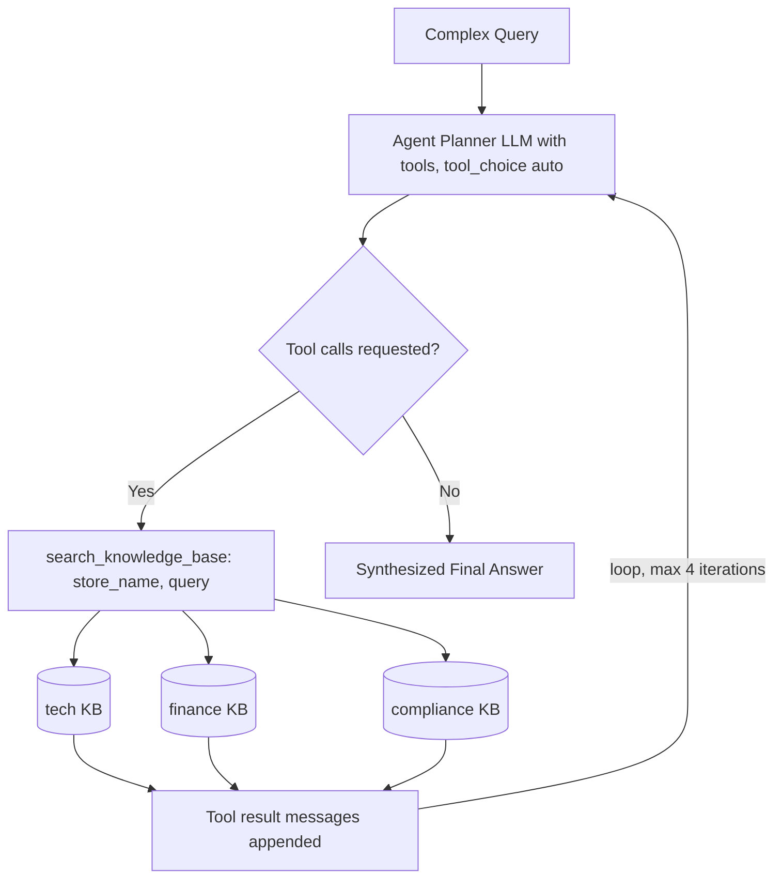

**Example Tool-Calling Sequence**

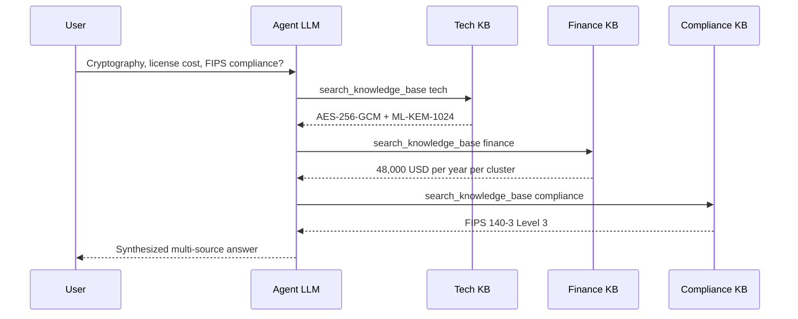

---

### 14] ReAct (Reason + Act) RAG
* **Definition**: A reasoning architecture that explicitly interleaves verbal reasoning ("Thought"), tool execution ("Action: Search"), and observation feedback ("Observation").
* **How It Works**: Executes a continuous loop: generates a thought $\rightarrow$ issues a retrieval action $\rightarrow$ observes the returned text $\rightarrow$ updates context $\rightarrow$ repeats until it reaches `Finish[answer]`.
* **Best For**: Step-by-step problem solving, math word problems with external facts, and interactive diagnostic environments.
* **Tradeoffs**: Highly interpretable reasoning trajectory that makes debugging easy, but can loop if actions fail to progress.


<!-- mermaid-14 -->
#### Architecture Diagram

**Architecture**

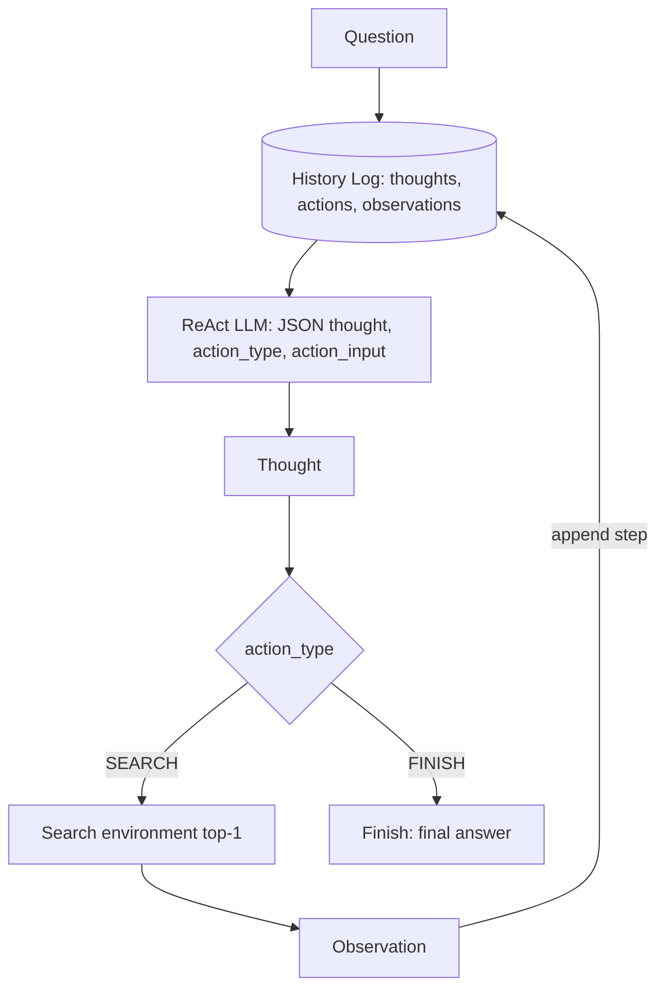

**Example Trajectory**

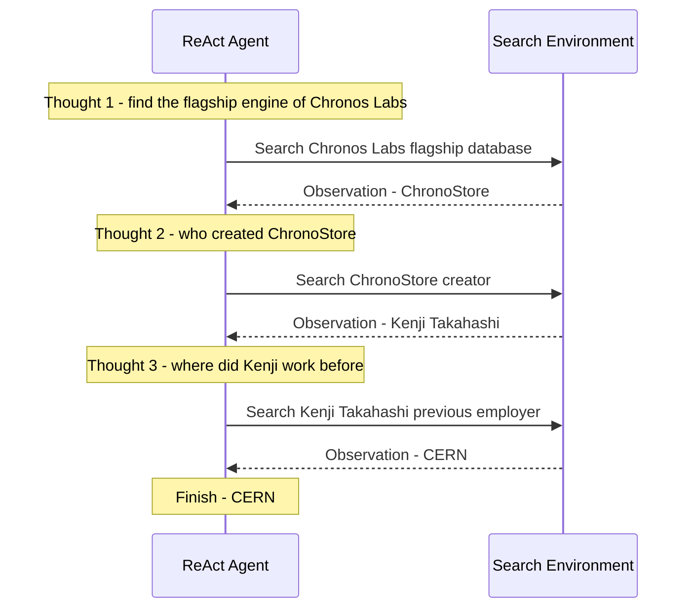

---

### 15] Rule RAG
* **Definition**: A neuro-symbolic RAG architecture that enforces deterministic business rules and logical constraints on both retrieval and generation.
* **How It Works**:
  1. *Rule-Guided Retrieval*: Uses domain rules to derive all legally/factually mandatory search queries.
  2. *Rule-Guided Generation*: Strictly constrains the generator LLM to adhere to policies and flag governing rules.
* **Best For**: Regulated industries such as loan underwriting, insurance adjudication, and clinical decision support.
* **Tradeoffs**: Prevents policy violations and ensures compliance, but requires maintaining a structured rule set.


<!-- mermaid-15 -->
#### Architecture Diagram

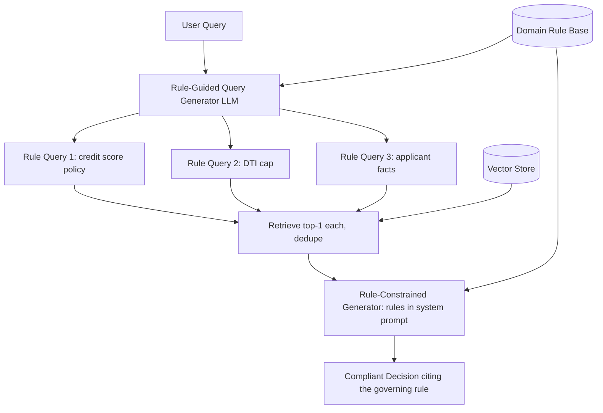

---

### 16] Graph RAG
* **Definition**: A knowledge-graph-augmented RAG system that models entities and relationships to answer multi-hop, cross-document relationship queries.
* **How It Works**: Extracts `(Subject, Relation, Object)` triples and clusters entities into communities with pre-computed summaries. Retrieval traverses multi-hop graph neighborhoods and merges community context with vector search.
* **Best For**: Investigative journalism, fraud detection, pharmaceutical discovery, and complex thematic queries.
* **Tradeoffs**: Excels at holistic, global corpus understanding, but building and maintaining the knowledge graph is resource-intensive.


<!-- mermaid-16 -->
#### Architecture Diagram

**Architecture**

```mermaid
flowchart TD
    subgraph BUILD["Graph Construction - offline"]
        DOCS["Documents"]
        EX["LLM Triple Extractor: source, relation, target, confidence"]
        TR["Triples"]
        CS["Community Summary"]
        ADJ[("Bidirectional Adjacency List")]
    end
    subgraph QUERY["Query Time"]
        Q["User Query"]
        SEED["LLM Seed Entity Selector"]
        BFS["BFS Traversal: max 2 hops, confidence at least 0.6"]
        PATHS["Relational Paths"]
        CTX["Graph Context"]
        G["Generator LLM"]
        A["Relational Answer"]
    end
    DOCS --> EX
    EX --> TR --> ADJ
    EX --> CS
    Q --> SEED
    ADJ --> SEED
    SEED --> BFS
    ADJ --> BFS
    BFS --> PATHS --> CTX
    CS --> CTX
    CTX --> G --> A
```

**Example Extracted Knowledge Graph**

```mermaid
graph LR
    BG["BioGenix"] -->|acquired| NP["NeuroPulse Labs"]
    NP -->|owns| SC["SynapCure"]
    MV["Dr. Marcus Vance"] -->|invented| SC
    MV -->|worked at| NP
    SC -->|inhibits| PK["Protein-Kinase-Z"]
    PK -->|drives| IX["Inflammation Syndrome X"]
```

---

### 17] RAPTOR (Recursive Abstractive Processing for Tree-Organized Retrieval)
* **Definition**: A hierarchical tree-structured RAG framework that recursively clusters and summarizes text chunks bottom-up.
* **How It Works**: Clusters base text chunks (Level 0) using semantic similarity and writes cluster summaries (Level 1), repeating recursively to the root (Level 2). Queries use *Collapsed Tree Retrieval* to search across all abstraction levels simultaneously.
* **Best For**: Long-form literature analysis, textbook Q&A, and answering high-level thematic questions alongside specific details.
* **Tradeoffs**: Unlocks multi-scale retrieval (macro themes + micro facts), but requires significant offline preprocessing.


<!-- mermaid-17 -->
#### Architecture Diagram

**Tree Build + Collapsed Retrieval**

```mermaid
flowchart TD
    CH["Leaf Chunks"] --> E0["Embed: Level 0 nodes"]
    E0 --> LOOP{"More than 1 node at current level?"}
    LOOP -->|Yes| CL["Farthest-first clustering, k = n/2"]
    CL --> SUM["LLM summarizes each cluster"]
    SUM --> EN["Embed summaries: Level L+1 nodes"]
    EN --> LOOP
    LOOP -->|No| TREE[("Collapsed Tree: every node, every level")]
    Q["Query"] --> QS["Cosine search over all tree nodes"]
    TREE --> QS
    QS --> TOP["Top-K mixed-level nodes"]
    TOP --> G["Generator LLM"]
    G --> A["Answer: broad themes + specific details"]
```

**Resulting Tree**

```mermaid
flowchart BT
    L1["Leaf: Q1 phishing incident"] --> C1["Level 1: Security incidents summary"]
    L2["Leaf: Q2 S3 bucket exposure"] --> C1
    L3["Leaf: Q3 mTLS service mesh"] --> C2["Level 1: Infrastructure upgrades summary"]
    L4["Leaf: Q4 HSM key rotation"] --> C2
    C1 --> ROOT["Level 2: Root summary - yearly security evolution"]
    C2 --> ROOT
```

---

### 18] ConTReGen (Context-Driven Tree-Structured Retrieval)
* **Definition**: A two-stage tree RAG framework that conducts top-down query planning followed by bottom-up answer synthesis.
* **How It Works**: Decomposes a complex root query top-down into a tree of facet sub-queries and leaf questions. Retrieves and verifies passages at each leaf node, then summarizes and integrates leaf findings upward to the root.
* **Best For**: Generating long-form whitepapers, comprehensive technical evaluations, and multi-part executive briefs.
* **Tradeoffs**: Eliminates information gaps in long-form generation, but involves multiple hierarchical LLM calls.


<!-- mermaid-18 -->
#### Architecture Diagram

```mermaid
flowchart TD
    ROOT["Root Query"] --> DEC["Stage 1 - Top-Down Decomposer LLM"]
    DEC --> F1["Facet 1"]
    DEC --> F2["Facet 2"]
    F1 --> L11["Leaf Query 1.1"] & L12["Leaf Query 1.2"]
    F2 --> L21["Leaf Query 2.1"] & L22["Leaf Query 2.2"]
    L11 --> S11["Retrieve + Verify + Summarize"]
    L12 --> S12["Retrieve + Verify + Summarize"]
    L21 --> S21["Retrieve + Verify + Summarize"]
    L22 --> S22["Retrieve + Verify + Summarize"]
    S11 & S12 --> FS1["Stage 2 - Facet 1 Synthesis"]
    S21 & S22 --> FS2["Stage 2 - Facet 2 Synthesis"]
    FS1 & FS2 --> RS["Root Integration LLM"]
    RS --> REP["Long-form Executive Report"]
```

---

### 19] Conversational RAG (CORAL)
* **Definition**: A conversational RAG architecture that models multi-turn dialogue dynamics and produces explicit inline citations.
* **How It Works**: Tracks dialogue flow, extracts entity titles, resolves conversational topic shifts, retrieves passages from titled articles, and labels every factual sentence with an inline bracket citation (`[Doc1]`).
* **Best For**: Multi-turn research assistants, educational chatbots, and customer support with auditability.
* **Tradeoffs**: Highly natural interaction with verifiable citations, but requires dialogue state tracking.


<!-- mermaid-19 -->
#### Architecture Diagram

```mermaid
flowchart TD
    U["Latest Utterance"] --> CTX["CORAL Contextualizer LLM"]
    HIST[("Dialogue Turns")] --> CTX
    CTX --> TI["Extracted Titles"]
    CTX --> CQ["De-contextualized Query"]
    CQ --> RET["Retrieve top-2 titled articles"]
    IDX[("Index: title + content embeddings")] --> RET
    RET --> FMT["Format passages with Doc IDs"]
    FMT --> GEN["Citation Generator: label every claim with its Doc ID"]
    GEN --> ANS["Cited Conversational Answer"]
    ANS --> HIST
```

---

### 20] Memo RAG
* **Definition**: A dual-model architecture pairing a lightweight working memory model with a heavy generator LLM.
* **How It Works**: A fast, light LLM (`gpt-4o-mini`) maintains a compressed global memory synopsis and generates precise retrieval "clues" from vague queries. A heavy LLM (`gpt-4o`) uses the clue-retrieved passages to generate the final answer.
* **Best For**: Disambiguating vague user queries across massive, multi-gigabyte document collections.
* **Tradeoffs**: Bridges ambiguous user intent to exact corpus terms with low latency, but requires maintaining global memory.


<!-- mermaid-20 -->
#### Architecture Diagram

```mermaid
flowchart TD
    subgraph INIT["Initialization"]
        CORP["Corpus"]
        GM["Light LLM builds Global Memory Index"]
        EMB[("Vector Store")]
    end
    CORP --> GM
    CORP --> EMB
    Q["Ambiguous Query"] --> CLUE["Light Memory Model gpt-4o-mini: draft + 2 clues"]
    GM --> CLUE
    CLUE --> DR["Memory Draft"]
    CLUE --> C1["Clue 1"] & C2["Clue 2"]
    C1 & C2 --> RET["Clue-based Retrieval top-1 each"]
    EMB --> RET
    RET --> HEAVY["Heavy Generator gpt-4o"]
    Q --> HEAVY
    HEAVY --> A["Final Answer"]
```

---

### 21] Speculative RAG
* **Definition**: A latency- and accuracy-optimized framework using parallel drafting across document subsets and centralized verification.
* **How It Works**: Partitions retrieved documents into focused subsets. A small, fast specialist model generates candidate drafts and rationales in parallel across subsets. A larger generalist verifier evaluates drafts and selects the best one.
* **Best For**: High-throughput production environments needing high accuracy without the latency of large-model processing over massive context.
* **Tradeoffs**: Cuts inference latency and prevents context dilution, but requires coordinating parallel drafting threads.


<!-- mermaid-21 -->
#### Architecture Diagram

```mermaid
flowchart TD
    Q["Query"] --> RET["Retrieve top-4 docs"]
    RET --> PART["Partition into subsets of 2"]
    PART --> S1["Subset 1"] & S2["Subset 2"]
    subgraph PAR["Parallel Specialist Drafting - ThreadPoolExecutor"]
        D1["Drafter gpt-4o-mini: draft + rationale"]
        D2["Drafter gpt-4o-mini: draft + rationale"]
    end
    S1 --> D1
    S2 --> D2
    D1 & D2 --> VER["Generalist Verifier gpt-4o: grounding, completeness, rationale"]
    VER --> SEL["selected_draft_id + verification_reason"]
    VER --> FIN["Final Verified Result"]
```

---

### 22] AutoRAG
* **Definition**: An automated optimization framework (AutoML for RAG) that tunes pipeline hyperparameters against a benchmark dataset.
* **How It Works**: Models the RAG pipeline as a node graph (`Query Expansion` $\rightarrow$ `Retrieval Top-K` $\rightarrow$ `Reranker`). Uses greedy evaluation with an LLM judge to automatically find the highest-accuracy module configuration.
* **Best For**: RAG engineering teams seeking empirical, data-driven optimization rather than manual trial-and-error.
* **Tradeoffs**: Guarantees optimal configuration for a given dataset, but requires an annotated evaluation benchmark.


<!-- mermaid-22 -->
#### Architecture Diagram

**Search Space**

```mermaid
flowchart LR
    BM["Benchmark Question + Ground Truth"] --> N1
    subgraph N1["Node 1: Query Expansion"]
        A1["passthrough"]
        A2["llm_expand"]
    end
    subgraph N2["Node 2: Retrieval top_k"]
        B1["k = 1"]
        B2["k = 2"]
    end
    subgraph N3["Node 3: Reranker"]
        C1["none"]
        C2["llm_rerank"]
    end
    N1 -->|"greedy best"| N2
    N2 -->|"greedy best"| N3
    N3 --> OPT["Optimal Configuration"]
```

**Greedy Optimization Loop**

```mermaid
flowchart TD
    START["Start: passthrough, k=1, none"] --> NODE{"Next node in search space?"}
    NODE -->|Yes| OPTN["For each option of this node"]
    OPTN --> TRIAL["Trial config = best config + this option"]
    TRIAL --> RUN["Expand, Retrieve, Rerank, Generate"]
    RUN --> JUDGE["LLM Judge vs ground truth: score 0-1"]
    JUDGE --> KEEP["Keep option if score is the best so far"]
    KEEP --> NODE
    NODE -->|No| OUT["Optimal config + trial history"]
```

---

### 23] CORAG (Cost-Constrained RAG)
* **Definition**: A combinatorial optimization RAG architecture that uses Monte Carlo Tree Search (MCTS) to select chunk subsets under strict token/cost budgets.
* **How It Works**: Accounts for non-monotonic utility (where redundant chunks reduce answer quality while adding cost). Uses MCTS with UCB1 exploration to find the chunk combination that maximizes information utility while staying under budget.
* **Best For**: High-volume commercial APIs, mobile applications, and cost-sensitive production deployments.
* **Tradeoffs**: Maximizes answer quality per dollar spent, but runs multiple MCTS simulation iterations during chunk selection.


<!-- mermaid-23 -->
#### Architecture Diagram

```mermaid
flowchart TD
    Q["Query + Token Budget, e.g. 90"] --> ROOT["MCTS Root: empty chunk set"]
    ROOT --> SEL["Selection: UCB1 = avg reward + 0.5 x sqrt of ln N / n"]
    SEL --> EXP["Expansion: add an unvisited chunk within budget"]
    EXP --> SIM["Simulation: LLM scores subset utility 0-1"]
    CACHE[("Utility Cache")] <--> SIM
    SIM --> BP["Backpropagation: update visits + rewards on path"]
    BP --> IT{"Iterations left?"}
    IT -->|Yes| SEL
    IT -->|No| BEST["Best Subset: max utility, cost within budget"]
    BEST --> G["Generator LLM"]
    G --> A["Answer"]
```

---

### 24] EACO-RAG (Edge-Assisted Collaborative RAG)
* **Definition**: A distributed edge-computing RAG architecture that optimizes latency, bandwidth, and cost via collaborative caching.
* **How It Works**: Distributes specialized vector indexes across low-latency local edge nodes and a central cloud node. Uses a multi-armed bandit algorithm to serve queries from edge nodes first, escalating to the cloud only when confidence is low, and caching new knowledge back at the edge.
* **Best For**: IoT networks, on-device mobile AI, branch-office enterprise infrastructure, and edge deployments.
* **Tradeoffs**: Delivers sub-20ms edge latency for frequent queries, but requires distributed cache synchronization.


<!-- mermaid-24 -->
#### Architecture Diagram

```mermaid
flowchart TD
    Q["Query"] --> EMB["Embed Query"]
    EMB --> E1["Edge-DevOps node, 12 ms"]
    EMB --> E2["Edge-Security node, 15 ms"]
    E1 & E2 --> BEST{"Best edge score at least 0.45?"}
    BEST -->|Yes| SERVE["Serve from Edge"]
    BEST -->|No| CL["Cloud-Global node, 185 ms"]
    CL --> CMP{"Cloud score better?"}
    CMP -->|No| SERVE
    CMP -->|Yes| CACHE["Adaptive Knowledge Update: cache doc on Edge-DevOps"]
    CACHE --> SERVE2["Serve from Cloud"]
    SERVE & SERVE2 --> BANDIT["Bandit reward = score - latency penalty - cost"]
    BANDIT --> G["Generator LLM"]
    G --> A["Answer + serving node + latency"]
```

---

### 25] REALM (Retrieval-Augmented Language Model)
* **Definition**: A seminal pre-trained architecture that integrates a neural knowledge retriever directly into the language model's pre-training loop.
* **How It Works**: Formulates retrieval probabilistically using Maximum Inner Product Search (MIPS) to compute $p(z \mid x)$. The generator marginalizes predictions over the top-$k$ retrieved documents: $p(y \mid x) = \sum_{z} p(y \mid z, x) \, p(z \mid x)$.
* **Best For**: Foundational open-domain question answering and deep model pre-training.
* **Tradeoffs**: Probabilistically sound and jointly trainable, but requires custom neural index structures for full-scale training.


<!-- mermaid-25 -->
#### Architecture Diagram

```mermaid
flowchart TD
    X["Query x"] --> QE["Embed x"]
    QE --> MIPS["MIPS: inner product x learnable doc weights"]
    DV[("Doc Vectors + weights")] --> MIPS
    MIPS --> TOPK["Top-K documents z"]
    TOPK --> SM["Temperature-scaled Softmax: p of z given x"]
    SM --> Z1["z1"] & Z2["z2"] & Z3["z3"]
    Z1 --> P1["Knowledge-Augmented Encoder: answer + p of y given z1, x"]
    Z2 --> P2["Knowledge-Augmented Encoder: answer + p of y given z2, x"]
    Z3 --> P3["Knowledge-Augmented Encoder: answer + p of y given z3, x"]
    P1 & P2 & P3 --> MARG["Marginalize: sum over z of p y given z,x times p z given x"]
    MARG --> Y["Highest-contribution prediction y"]
```

---

### 26] RETRO (Retrieval-Enhanced Transformer)
* **Definition**: DeepMind's autoregressive architecture that integrates chunked cross-attention directly into transformer layers.
* **How It Works**: Breaks ongoing text generation into fixed-size chunks. For each chunk $C_u$, it retrieves $k$-NN neighbor chunks *and their subsequent continuation chunks* from a trillion-token database, conditioning generation via cross-attention.
* **Best For**: Large-scale language model pre-training with external memory, reducing parameter counts while maintaining knowledge depth.
* **Tradeoffs**: Enables smaller models to match the knowledge capacity of 10x larger models, but requires custom transformer architectures.


<!-- mermaid-26 -->
#### Architecture Diagram

```mermaid
flowchart TD
    subgraph DB["Retrieval Database"]
        PAIRS[("Neighbor chunk N_i paired with continuation F_i")]
    end
    PRE["Prompt Prefix C_1"] --> ACT["Active Chunk C_u"]
    ACT --> KNN["k-NN search on neighbor embeddings, k=2"]
    PAIRS --> KNN
    KNN --> NF["Retrieved pairs N, F"]
    NF --> CCA["Chunked Cross-Attention Decoder LLM"]
    SEQ[("Sequence so far")] --> CCA
    CCA --> NEXT["Next chunk C_u+1"]
    NEXT --> SEQ
    NEXT -->|"repeat num_chunks times"| ACT
    SEQ --> OUT["Full Generated Sequence"]
```

---

### 27] ATLAS (Attention-Based Fusion-in-Decoder RAG)
* **Definition**: Meta AI's few-shot retrieval-augmented model utilizing Fusion-in-Decoder (FiD) with a hot-updatable document index.
* **How It Works**: Pairs a dual-encoder retriever with an FiD reader. Each `(Query, Passage)` pair is encoded independently, and the decoder attends across all passage representations simultaneously, weighted by attention salience.
* **Best For**: Few-shot learning, knowledge-intensive tasks, and corpora requiring frequent updates without retraining.
* **Tradeoffs**: High parameter efficiency and instant knowledge updates, but cross-attention over many passages increases decoder compute.


<!-- mermaid-27 -->
#### Architecture Diagram

```mermaid
flowchart TD
    NEW["New Documents"] --> HOT["Hot Index Update - no retraining"]
    HOT --> IDX[("Document Index")]
    Q["Query"] --> DE["Dual-Encoder Retrieval top-3"]
    IDX --> DE
    DE --> P1["Passage 1"] & P2["Passage 2"] & P3["Passage 3"]
    P1 --> E1["Encoder: query + passage 1 to representation + attention weight"]
    P2 --> E2["Encoder: query + passage 2 to representation + attention weight"]
    P3 --> E3["Encoder: query + passage 3 to representation + attention weight"]
    E1 & E2 & E3 --> SORT["Sort by attention weight"]
    SORT --> FID["Fusion-in-Decoder Reader"]
    FID --> A["Answer"]
```

---

### 28] REPLUG (Retrieval-Augmented Black-Box Language Models)
* **Definition**: A framework that adapts frozen, black-box LLMs for retrieval augmentation through parallel prepending and ensemble decoding.
* **How It Works**: Computes retrieval probability $P(d_i \mid x)$ for top-$k$ documents. Instead of concatenating all docs into one prompt, it prepends each document *individually* to the query in parallel passes, ensembling output probabilities.
* **Best For**: Commercial closed-source LLMs (e.g., OpenAI, Anthropic) where model weights and internal attention cannot be modified.
* **Tradeoffs**: Works with any black-box API and avoids long-context degradation, but requires parallel API calls per document.


<!-- mermaid-28 -->
#### Architecture Diagram

```mermaid
flowchart TD
    X["Query x"] --> RET["Retrieve top-3 by cosine"]
    RET --> SMX["Softmax with tau = 0.1: P of d_i given x"]
    SMX --> D1["Prepend d1 to x"] & D2["Prepend d2 to x"] & D3["Prepend d3 to x"]
    D1 --> L1["Frozen Black-Box LLM pass 1: answer + confidence"]
    D2 --> L2["Frozen Black-Box LLM pass 2: answer + confidence"]
    D3 --> L3["Frozen Black-Box LLM pass 3: answer + confidence"]
    L1 --> W1["Weight = P of d1 given x times confidence"]
    L2 --> W2["Weight = P of d2 given x times confidence"]
    L3 --> W3["Weight = P of d3 given x times confidence"]
    W1 & W2 & W3 --> ENS["Ensemble Aggregator LLM"]
    ENS --> A["Ensembled Answer"]
```

---

### 29] Multimodal RAG
* **Definition**: An architecture that unifies retrieval and synthesis across text, structured tables, and visual media (charts, diagrams, images).
* **How It Works**: Converts images and charts into dense semantic summaries using OpenAI Vision, indexes text and tables alongside visual summaries in a unified vector space, and passes both text and raw image payloads to the vision model for synthesis.
* **Best For**: Engineering schematics, financial reports with charts, medical diagnostic imaging, and multi-format document analysis.
* **Tradeoffs**: Handles any document format seamlessly, but image encoding and multimodal inference increase token cost.


<!-- mermaid-29 -->
#### Architecture Diagram

```mermaid
flowchart TD
    subgraph INGEST["Multimodal Ingestion"]
        TXT["Text"]
        TAB["Markdown Table"]
        IMG["Image / Chart, base64"]
        VIS["Vision Captioner gpt-4o-mini"]
        TAG["Modality-tagged summaries"]
        EMB[("Unified Vector Space")]
    end
    TXT --> TAG
    TAB --> TAG
    IMG --> VIS --> TAG
    TAG --> EMB
    Q["Query"] --> S["Cross-modal Cosine Search top-3"]
    EMB --> S
    S --> BLK["Content blocks: text summaries + raw image_url"]
    BLK --> VLM["Vision Generator gpt-4o-mini"]
    VLM --> A["Multimodal Answer"]
```

---

### 30] REVEAL (Retrieval-Augmented Visual-Language Model)
* **Definition**: A visual-language reasoning architecture that grounds multimodal scene understanding in external structured knowledge.
* **How It Works**: Combines vision transformers and text encoders to encode visual scenes + task queries into a unified representation. Retrieves external real-world facts and performs knowledge fusion with gated attention for step-by-step reasoning.
* **Best For**: Visual defect inspection, robotic scene manipulation, autonomous navigation, and visual troubleshooting.
* **Tradeoffs**: Provides verifiable, grounded reasoning steps for physical scenes, but requires aligned visual-semantic embeddings.


<!-- mermaid-30 -->
#### Architecture Diagram

```mermaid
flowchart TD
    IMG["Image, base64"] --> QENC["Visual-Text Query Encoder VLM"]
    SCN["Scene Description"] --> QENC
    QQ["Task Question"] --> QENC
    QENC --> EQ["Encoded Visual Query"]
    EQ --> MEM["Memory Retrieval top-2"]
    KB[("External Knowledge Base")] --> MEM
    MEM --> FUS["Knowledge Fusion Generator"]
    SCN --> FUS
    QQ --> FUS
    FUS --> STEPS["Step-by-step reasoning"]
    FUS --> OUT["Grounded Output"]
```

---

### 31] CRAT (Causality-Enhanced Reflective Translation RAG)
* **Definition**: A multi-agent RAG system designed for high-accuracy translation of domain-heavy, polysemous, or causally sensitive text.
* **How It Works**:
  1. *Unknown Terms Detector*: Flags ambiguous or technical terms.
  2. *Knowledge Graph Constructor*: Retrieves authoritative domain definitions.
  3. *Translator*: Generates draft translations conditioned on the KG.
  4. *Causality Judge*: Validates that cause-and-effect relationships and technical definitions are preserved in the target language.
* **Best For**: Translating patent applications, medical trial protocols, semiconductor engineering specs, and legal contracts.
* **Tradeoffs**: Eliminates subtle mistranslations and preserves causal semantics, but multi-agent validation adds compute overhead.


<!-- mermaid-31 -->
#### Architecture Diagram

```mermaid
flowchart TD
    SRC["Source Text"] --> A1["Agent 1: Unknown Terms Detector"]
    A1 --> TERMS["Ambiguous Terms"]
    TERMS --> A2["Agent 2: KG Constructor - retrieve definition per term"]
    GL[("Domain Glossary Vectors")] --> A2
    A2 --> KG["Term Knowledge Graph"]
    KG --> A3["Agent 3: Translator"]
    SRC --> A3
    A3 --> DRAFT["Draft Translation"]
    DRAFT --> A4{"Agent 4: Causality Judge"}
    KG --> A4
    SRC --> A4
    A4 -->|"causality valid"| OK["Refined Translation"]
    A4 -->|"mismatch found"| FIX["Critique + correction"]
    FIX --> OK
```

---

## Evaluation: The RAG Triad (`rag_evaluator.py`)

Every implementation in this repository can be evaluated using the included **RAG Triad Evaluator** (`rag_evaluator.py`), which scores outputs using an LLM-as-a-Judge on three fundamental dimensions:

1. **Context Relevance**: Measures how relevant and noise-free the retrieved documents are for answering the question.
2. **Faithfulness**: Measures whether every claim in the generated answer is strictly grounded in the context without hallucinations.
3. **Answer Relevance**: Measures how directly and completely the final answer satisfies the user's intent.

```bash
python3 rag_evaluator.py
```
